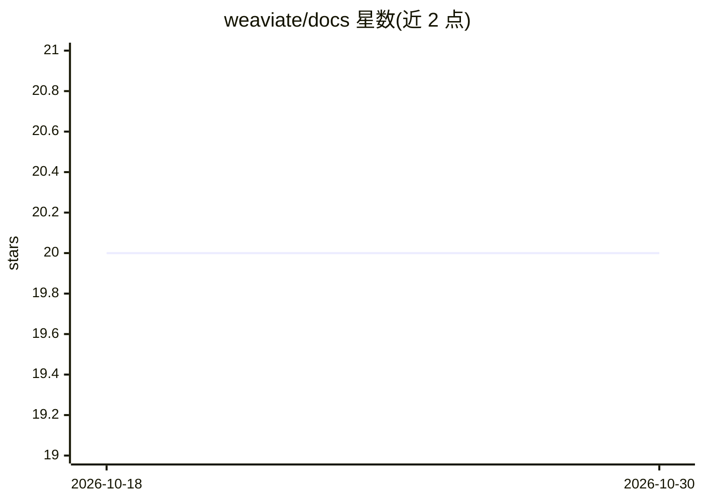

# weaviate/docs

⭐ 20 · Python · 推送 2026-10-29 · [GitHub](https://github.com/weaviate/docs) · [官网](https://docs.weaviate.io) · 组织维护

**Weaviate 数据库、云服务与 Query Agent 的官方文档仓库**

docs.weaviate.io 的源仓库，收录 Weaviate 向量数据库、Weaviate Cloud、部署与 Query Agent 的 MDX 文档。基于 Docusaurus 3 构建，通过 yarn 安装依赖并本地运行/构建站点；文档含多级导航、动态版本管理、代码片段复用组件、链接校验，并由 Netlify 自动部署。面向文档贡献者与 Weaviate 使用者；代码示例经 pytest/Maven/go test 及 Docker Compose 起测实例验证。

## 筛选速览

| 维度 | 判定 | 备注 |
|---|---|---|
| AI 角色 | `ai-knowledge` | 知识聚合/清单类 |
| 许可风险 | `none` | — |
| 部署形态 | `self-host` | docker 或自建部署 |
| 模型依赖 | — | README 未给出锁定关系 |
| 硬件要求 | — | 无带数字的原话,不猜 |
| 安装摩擦 | `low` | 无编译、无系统依赖或容器化 |
| 成熟度 | — | 结构信号不足 |

## 能力要点

- MDX 文档按 weaviate/deploy/cloud/query-agent 目录组织
- FilteredTextBlock 组件从可运行代码文件抽取片段保证示例可测
- versions-config.json 构建时自动从 GitHub 拉取最新版本号
- PR 前强制链接校验（yarn validate-links-dev）

## 适用场景

- 查阅 Weaviate 向量数据库与云服务的使用文档
- 为 Weaviate 文档提交修改并本地预览
- 了解 Docusaurus 大型文档站的工程化实践

## 场景标签

 · 领域:开发者文档/向量数据库

## 证据(README 行号)

> L5: This repository contains the documentation for Weaviate (vector database), Weaviate Cloud, and Query Agent. It's bui
> L29: - **`/docs/weaviate/`** → Main database documentation

## 星数曲线

2026-10-18 20 → 2026-10-30 20（+0）

---
*卡片 v1 · prompt 1.4 · 生成 2026-10-28 · 置信度 mid · 依据 README sha `90d271087705` · [字段定义](../../DATASET.md)*
