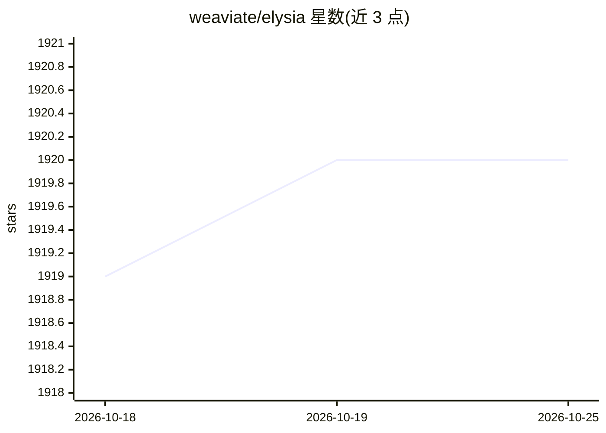

# weaviate/elysia

⭐ 1,920 · Python · BSD-3-Clause · 推送 2026-02-06 · [GitHub](https://github.com/weaviate/elysia) · 组织维护

**决策树式 agentic 框架：动态选择工具检索 Weaviate 数据**

Weaviate 维护的开源 agentic 平台：以预定义决策树组织节点，由具备全局上下文感知的决策 agent 动态选择工具（含预置的查询/聚合工具）检索 Weaviate 集群中的数据，也支持自定义工具。同时以 pip 包与 FastAPI 后端加前端的 Web 应用两种形式提供，LLM 交互由 DSPy 处理。声明处于 beta，需 Python 3.12（源码方式支持 3.10-3.12），可连接本地 Weaviate 与 Ollama 本地模型。

## 筛选速览

| 维度 | 判定 | 备注 |
|---|---|---|
| AI 角色 | `ai-ecosystem` | LLM/agent 周边工具 |
| 许可风险 | `permissive` | BSD-3-Clause |
| 部署形态 | `library` | 以包/库形式分发 |
| 模型依赖 | local-ok | 支持本地模型 |
| 硬件要求 | — | 无带数字的原话,不猜 |
| 安装摩擦 | `low` | 无编译、无系统依赖或容器化 |
| 成熟度 | `idea` | |

## 能力要点

- 决策树节点架构，决策 agent 动态选择工具
- 预置 query/aggregate 工具直接检索 Weaviate 集群
- Python 库与 Web 应用（elysia start）双形态，FastAPI 后端
- LLM 交互由 DSPy 处理，推荐经 OpenRouter 接多种模型

## 适用场景

- 对自己的 Weaviate 数据集做自然语言检索与分析
- 用自定义工具构建决策树式 agent 工作流
- 在本地（本地 Weaviate + Ollama）运行 agentic 检索

## 场景标签

`Agent 框架` `数据分析` · 领域:Agent 开发

## 证据(README 行号)

> L9: Elysia is an agentic platform designed to use tools in a decision tree. A decision agent decides which tools to use 
> L135: Unlike simple agentic platforms which have access to all possible tools at runtime, Elysia has a pre-defined web o

## 星数曲线

2026-10-18 1,919 → 2026-10-25 1,920（+1）

---
*卡片 v1 · prompt 1.4 · 生成 2026-10-21 · 置信度 high · 依据 README sha `00540cd23ab1` · [字段定义](../../DATASET.md)*
