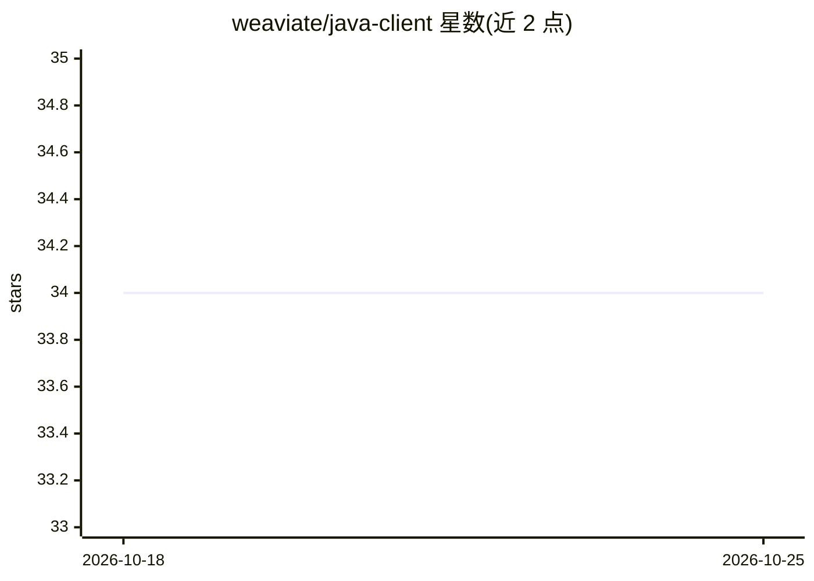

# weaviate/java-client

⭐ 34 · Java · BSD-3-Clause · 推送 2026-10-22 · [GitHub](https://github.com/weaviate/java-client) · 组织维护

**Weaviate 向量数据库的官方 Java 客户端库**

面向 Java 开发者的 Weaviate 数据库官方客户端（client6，v6.3.1）：通过 HTTP 与 gRPC 连接 Weaviate 实例，支持 API Key、Resource owner password、Client credentials 等多种认证方式。提供集合管理、单条与批量数据写入（含自定义 UUID 与一维/多维向量）、语义搜索（nearVector/nearText）与混合查询等 API。采用 Tucked Builder 模式以 lambda 表达式减少样板代码，另含内置 ORM 支持自定义 Java 类型。限制：需 Weaviate v1.32+；Java 9+ 需添加 --add-opens JVM 参数；动态批处理尚未支持。以 Maven 依赖形式提供，含 shaded uber-JAR 版本。

## 筛选速览

| 维度 | 判定 | 备注 |
|---|---|---|
| AI 角色 | `ai-ecosystem` | LLM/agent 周边工具 |
| 许可风险 | `permissive` | BSD-3-Clause |
| 部署形态 | `None` |  |
| 模型依赖 | — | README 未给出锁定关系 |
| 硬件要求 | — | 无带数字的原话,不猜 |
| 安装摩擦 | `medium` | 含编译或系统依赖之一 |
| 成熟度 | — | 结构信号不足 |

## 能力要点

- Tucked Builder 模式以 lambda 表达式构建查询，减少样板代码
- 支持一维与多维（ColBERT 族）向量嵌入的 Vectors 抽象
- 内置 ORM 可将对象属性映射为自定义 Java 类型
- 支持本地实例、自定义连接与 Weaviate Cloud（含 API Key 认证）三种连接方式

## 适用场景

- 在 Java 应用中连接并操作 Weaviate 向量数据库
- 以强类型方式写入向量数据并执行语义/混合搜索
- 构建 uber-JAR 时使用 shaded 版本正确解析 gRPC 依赖

## 场景标签

`向量数据库` · 领域:知识与检索

## 证据(README 行号)

> L5: Official Weaviate Java Client.
> L307: songs.query.nearVector(

## 星数曲线

2026-10-18 34 → 2026-10-25 34（+0）

---
*卡片 v1 · prompt 1.4 · 生成 2026-10-25 · 置信度 high · 依据 README sha `b7bf0ce40edc` · [字段定义](../../DATASET.md)*
