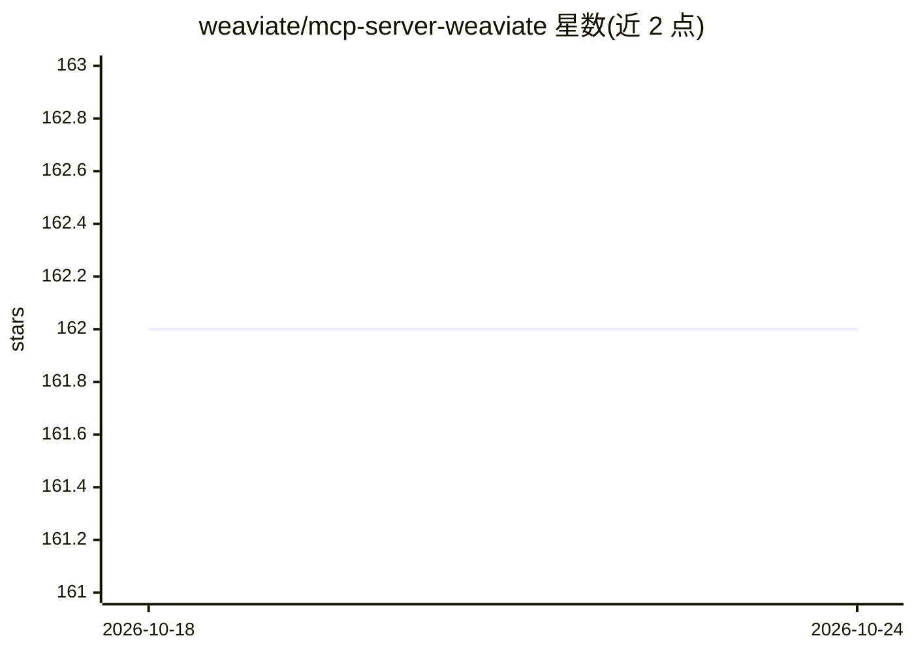

# weaviate/mcp-server-weaviate

⭐ 162 · 推送 2026-05-26 · [GitHub](https://github.com/weaviate/mcp-server-weaviate) · [官网](https://www.anthropic.com/news/model-context-protocol) · 组织维护

**Weaviate 的 MCP 服务器（已弃用，已并入 Weaviate 主程序）**

原为封装 Weaviate REST API 的独立 Go 实现 MCP 服务器，现已被弃用：Weaviate v1.37.1 起在主二进制内内置 MCP 服务器，通过 MCP_SERVER_ENABLED=true 环境变量启用，监听 /v1/mcp，复用现有 API-key 认证与 RBAC。暴露 4 个工具：查看集合配置、列出多租户集合的租户、混合（向量+关键词）检索、对象创建/更新。本仓库保留 git 历史供参考，不再维护。

## 筛选速览

| 维度 | 判定 | 备注 |
|---|---|---|
| AI 角色 | `ai-ecosystem` | LLM/agent 周边工具 |
| 许可风险 | `none` | — |
| 部署形态 | `None` |  |
| 模型依赖 | — | README 未给出锁定关系 |
| 硬件要求 | — | 无带数字的原话,不猜 |
| 安装摩擦 | `low` | 无编译、无系统依赖或容器化 |
| 成熟度 | — | 结构信号不足 |

## 能力要点

- 独立服务器已弃用，MCP 功能并入 Weaviate 主二进制（v1.37.1 起 preview）
- 内置服务器复用现有 API-key 认证并遵循 RBAC
- 暴露集合配置/租户列表/混合检索/对象 upsert 四个工具

## 适用场景

- 通过 MCP 协议让 AI 客户端查询与写入 Weaviate 数据
- 在多租户 Weaviate 集合中列出租户与执行混合检索

## 场景标签

 · 领域:数据库/AI 基础设施

## 证据(README 行号)

> L3: > **This standalone server is deprecated.** The Weaviate Model Context Protocol (MCP) server is now built into Weavi
> L13: It listens on the same port as the Weaviate REST API at `/v1/mcp`, authenticates via the existing API-key flow, and
> L32: Earlier versions of this repo contained a standalone Go implementation of an MCP server that wrapped the Weaviate R

## 星数曲线

2026-10-18 162 → 2026-10-24 162（+0）

---
*卡片 v1 · prompt 1.4 · 生成 2026-10-22 · 置信度 high · 依据 README sha `35ed452bf5fa` · [字段定义](../../DATASET.md)*
