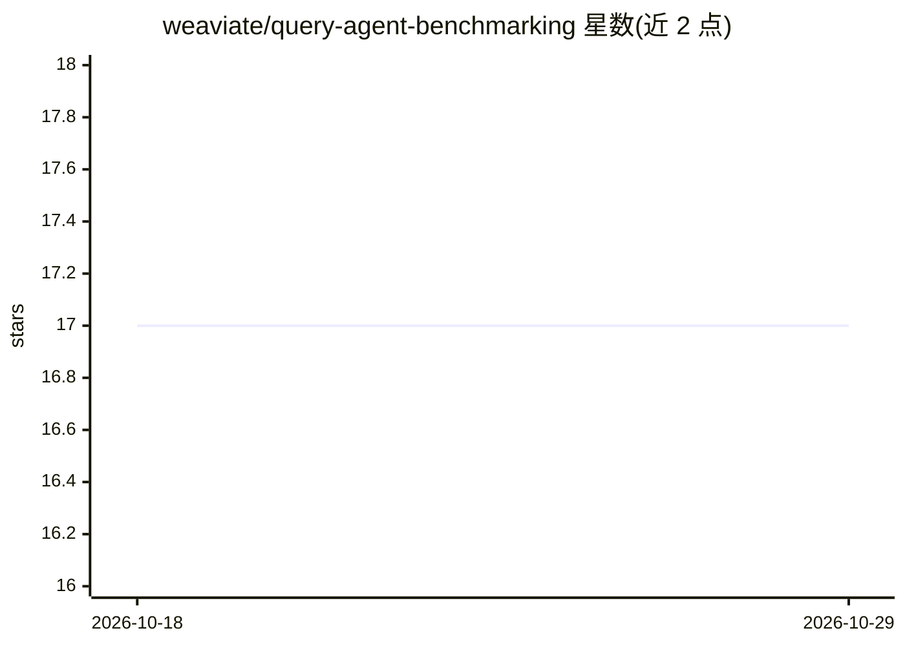

# weaviate/query-agent-benchmarking

⭐ 17 · Jupyter Notebook · BSD-3-Clause · 推送 2026-10-27 · [GitHub](https://github.com/weaviate/query-agent-benchmarking) · 组织维护

**评测检索与问答系统的基准工具，为 Weaviate Query Agent 而建**

由 Weaviate 维护的评测工具，提供两种模式：Search 模式用 IR 指标（Recall@K、nDCG@K、Coverage、alpha-nDCG）评测排序检索；Ask 模式用 LLM-as-judge（基于 DSPy 的集成投票）或精确匹配评测问答。内置支持 Weaviate 的 agent，同时可通过实现 SearchAgent 协议接入任意检索器，支持自定义问答对与 Weaviate 集合中的数据。提供命令行脚本与 Python 库两种用法。

## 筛选速览

| 维度 | 判定 | 备注 |
|---|---|---|
| AI 角色 | `ai-ecosystem` | LLM/agent 周边工具 |
| 许可风险 | `permissive` | BSD-3-Clause |
| 部署形态 | `library` | 以包/库形式分发 |
| 模型依赖 | — | README 未给出锁定关系 |
| 硬件要求 | — | 无带数字的原话,不猜 |
| 安装摩擦 | `low` | 无编译、无系统依赖或容器化 |
| 成熟度 | — | 结构信号不足 |

## 能力要点

- Search/Ask 双模式：IR 指标与 LLM-as-judge（DSPy 集成投票）评测
- 实现 SearchAgent 协议即可接入任意检索系统
- 支持从 Weaviate 集合加载自定义问答对与查询
- 通过 benchmark-config.yml 配置数据集、agent 类型、样本数与并发

## 适用场景

- 评测 RAG 或检索系统的排序质量（Recall@K、nDCG@K）
- 评测问答系统的回答质量并自动判定
- 用自己的检索器或数据集跑标准化基准

## 场景标签

`模型评测` · 领域:评测与运维

## 证据(README 行号)

> L3: A tool for benchmarking retrieval and question answering systems. Built for Weaviate's Query Agent, but designed to 
> L5: It supports two evaluation modes:

## 星数曲线

2026-10-18 17 → 2026-10-29 17（+0）

---
*卡片 v1 · prompt 1.4 · 生成 2026-10-29 · 置信度 high · 依据 README sha `f42add9c453f` · [字段定义](../../DATASET.md)*
