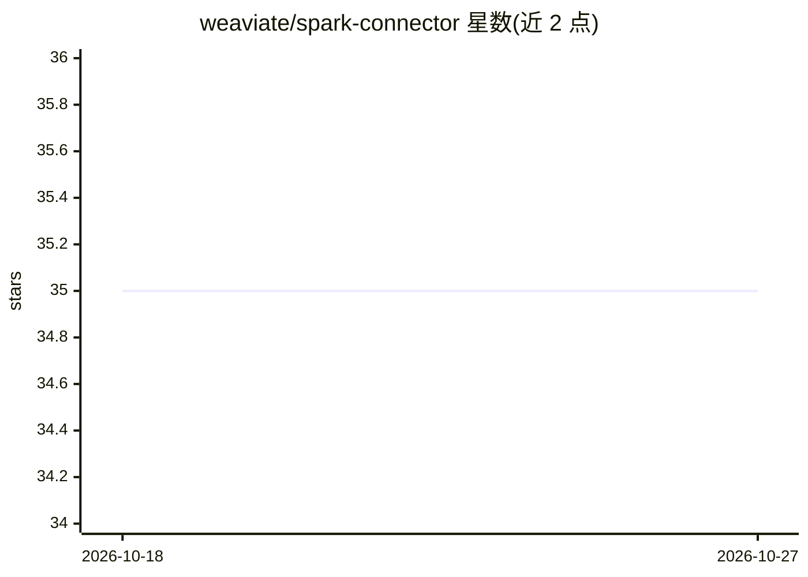

# weaviate/spark-connector

⭐ 35 · Scala · BSD-3-Clause · 推送 2025-12-08 · [GitHub](https://github.com/weaviate/spark-connector) · [官网](https://weaviate.io/developers/weaviate/tutorials/spark-connector) · 组织维护

**Apache Spark 向 Weaviate 向量库写入数据的连接器**

面向 Spark 作业的 Weaviate 连接器，提供 DataFrame 到 Weaviate 向量数据库的批量与流式写入。要求先在 Weaviate 侧手工创建 schema（连接器不自动建）。支持从 DataFrame 列提供向量与自定义文档 ID，支持 apiKey/OIDC 等认证；写模式目前仅 append，不支持 upsert。自动推断 Spark 与 Weaviate 数据类型映射，cross reference 尚不支持。以 JAR（GitHub 下载/sbt 自构建/Maven）方式集成到 spark-shell、spark-submit 或 Databricks。编译需 Java 8+ 与 Scala 2.12。

## 筛选速览

| 维度 | 判定 | 备注 |
|---|---|---|
| AI 角色 | `ai-ecosystem` | LLM/agent 周边工具 |
| 许可风险 | `permissive` | BSD-3-Clause |
| 部署形态 | `self-host` | docker 或自建部署 |
| 模型依赖 | — | README 未给出锁定关系 |
| 硬件要求 | — | 无带数字的原话,不猜 |
| 安装摩擦 | `low` | 无编译、无系统依赖或容器化 |
| 成熟度 | — | 结构信号不足 |

## 能力要点

- DataFrame 批量与流式写入 Weaviate
- 自动推断 Spark 与 Weaviate 数据类型映射
- 支持 DataFrame 提供向量与自定义文档 ID
- apiKey/OIDC/自定义 header 认证

## 适用场景

- Spark 管道中批量导入向量数据到 Weaviate
- Databricks 集群上向 Weaviate 写入数据
- 已有向量与 ID 的 DataFrame 直接写入

## 场景标签

`向量数据库` · 领域:知识与检索

## 证据(README 行号)

> L2: For use in Spark jobs to populate a Weaviate vector database.
> L84: Both batch operations and streaming writes are supported.

## 星数曲线

2026-10-18 35 → 2026-10-27 35（+0）

---
*卡片 v1 · prompt 1.4 · 生成 2026-10-25 · 置信度 mid · 依据 README sha `ce155311d3d5` · [字段定义](../../DATASET.md)*
