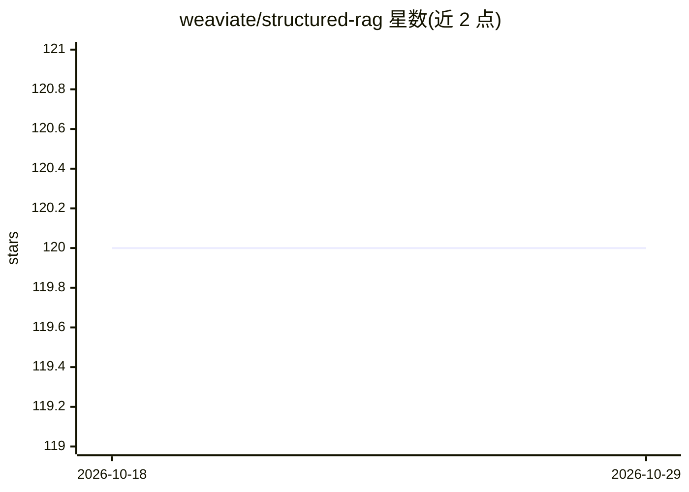

# weaviate/structured-rag

⭐ 120 · Jupyter Notebook · 推送 2026-04-27 · [GitHub](https://github.com/weaviate/structured-rag) · [官网](https://arxiv.org/abs/2408.11061) · 组织维护

**评测 LLM 在 RAG 任务中遵循 JSON 格式指令能力的基准**

由 Weaviate 团队发布的实验性基准代码：在 7 个 RAG 风格的结构化输出任务（string/integer/boolean/List/composite 等不同 JSON 复杂度）上，测试 LLM 遵循 JSON 响应格式指令的能力，报告 JSON 格式成功率和任务准确率两个独立指标。开箱支持 OpenAI、Anthropic、Google、Ollama 和 Modal/vLLM 提供商，提供 4 种提示策略（f-string、provider-native structured outputs、DSPy FF、DSPy OPRO），采用六边形架构，新增提供商只需实现 LLMPort 适配器并注册。配套 WikiQuestions 数据集（112 样本，亦在 HuggingFace Datasets 提供），研究论文发布于 ArXiv。限制：代码标注为 Experimental。

## 筛选速览

| 维度 | 判定 | 备注 |
|---|---|---|
| AI 角色 | `ai-ecosystem` | LLM/agent 周边工具 |
| 许可风险 | `none` | — |
| 部署形态 | `None` |  |
| 模型依赖 | local-ok | 支持本地模型 |
| 硬件要求 | — | 无带数字的原话,不猜 |
| 安装摩擦 | `low` | 无编译、无系统依赖或容器化 |
| 成熟度 | — | 结构信号不足 |

## 能力要点

- 7 个 RAG 风格结构化输出任务，覆盖不同 JSON 复杂度
- 双指标：JSON 格式成功率与任务准确率
- 开箱支持 OpenAI/Anthropic/Google/Ollama/Modal vLLM 五类提供商
- 4 种提示策略含 DSPy FF 与 OPRO 优化

## 适用场景

- 我需要评估各 LLM 生成合法 JSON 结构化输出的能力
- 对比不同提示策略对 JSON 格式遵循度的影响
- 为新 LLM 提供商编写适配器并纳入基准测试

## 场景标签

`模型评测` · 领域:评测与运维

## 证据(README 行号)

> L3: A benchmark for measuring how well LLMs follow JSON response format instructions across RAG-inspired tasks. Supports
> L88: - **JSON Format Success Rate** -- did the LLM produce valid, parseable JSON matching the expected schema?

## 星数曲线

2026-10-18 120 → 2026-10-29 120（+0）

---
*卡片 v1 · prompt 1.4 · 生成 2026-10-23 · 置信度 high · 依据 README sha `99982a56434c` · [字段定义](../../DATASET.md)*
