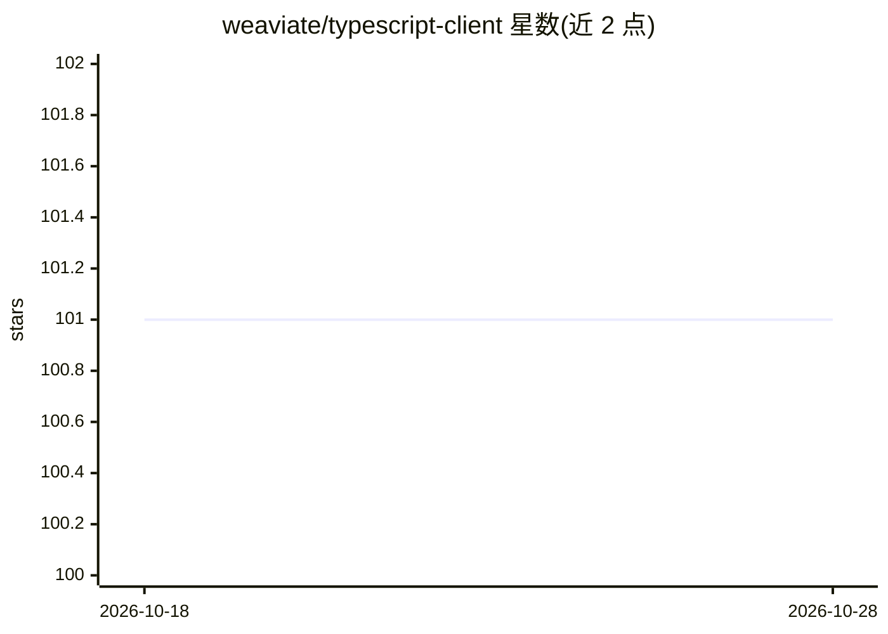

# weaviate/typescript-client

⭐ 101 · TypeScript · BSD-3-Clause · 推送 2026-10-28 · [GitHub](https://github.com/weaviate/typescript-client) · [官网](https://npmjs.com/package/weaviate-client) · 组织维护

**Weaviate 官方 JS/TS 客户端库：便捷交互向量数据库实例**

Weaviate 官方维护的 JavaScript/TypeScript 客户端库，用于在 JS/TS 应用中与 Weaviate 向量数据库实例交互。README 内容简短，仅说明其为官方客户端并链接通用文档与客户端文档，未列出具体 API 能力或安装步骤细节，具体功能需查阅链接的文档。面向将 Weaviate 的向量检索/生成式搜索能力接入 JS/TS 项目的开发者。

## 筛选速览

| 维度 | 判定 | 备注 |
|---|---|---|
| AI 角色 | `ai-ecosystem` | LLM/agent 周边工具 |
| 许可风险 | `permissive` | BSD-3-Clause |
| 部署形态 | `None` |  |
| 模型依赖 | — | README 未给出锁定关系 |
| 硬件要求 | — | 无带数字的原话,不猜 |
| 安装摩擦 | `low` | 无编译、无系统依赖或容器化 |
| 成熟度 | — | 结构信号不足 |

## 能力要点

- Weaviate 官方维护的 JS/TS 客户端
- 提供通用与客户端专属文档链接

## 适用场景

- 在 JS/TS 项目中连接并操作 Weaviate 实例
- 查阅官方文档了解客户端 API 用法

## 场景标签

`向量数据库` · 领域:知识与检索

## 证据(README 行号)

> L3: Official JS/TS client for easy interaction with a Weaviate instance.

## 星数曲线

2026-10-18 101 → 2026-10-28 101（+0）

---
*卡片 v1 · prompt 1.4 · 生成 2026-10-23 · 置信度 low · 依据 README sha `5fc80e2f6283` · [字段定义](../../DATASET.md)*
