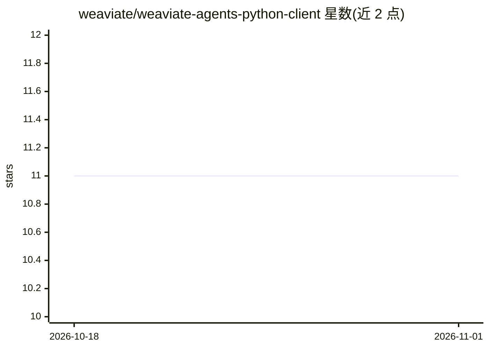

# weaviate/weaviate-agents-python-client

⭐ 11 · Python · BSD-3-Clause · 推送 2026-10-30 · [GitHub](https://github.com/weaviate/weaviate-agents-python-client) · 组织维护

**面向 Weaviate 数据库的自然语言查询 Agent Python 客户端**

Weaviate 官方 Python 客户端的子包，提供 Query Agent 接口：将自然语言问题转换为数据库操作，支持动态过滤、跨集合路由、查询优化与聚合，并返回带来源引用的结果。提供 Ask 模式（自然语言问答，支持流式与异步）与 Search 模式（高召回信息检索、不生成最终答案），后者可定制过滤策略、effort 级别、多样性权重与分页。作为 weaviate-client 的可选 extra 安装，需 Python 3.9+ 与 Weaviate Cloud 集群。附 arXiv 论文可引用。

## 筛选速览

| 维度 | 判定 | 备注 |
|---|---|---|
| AI 角色 | `ai-ecosystem` | LLM/agent 周边工具 |
| 许可风险 | `permissive` | BSD-3-Clause |
| 部署形态 | `library` | 以包/库形式分发 |
| 模型依赖 | — | README 未给出锁定关系 |
| 硬件要求 | — | 无带数字的原话,不猜 |
| 安装摩擦 | `low` | 无编译、无系统依赖或容器化 |
| 成熟度 | — | 结构信号不足 |

## 能力要点

- 自然语言转数据库操作：动态过滤、跨集合路由、聚合与查询优化
- Ask 模式回答问题并附来源引用，支持流式输出与异步客户端
- Search 模式提供可调 recall/precision 权衡的检索，不生成最终答案
- 以 weaviate-client[agents] 可选 extra 形式安装

## 适用场景

- 对 Weaviate 集合用自然语言提问并获得带引用的回答
- 在应用中集成自然语言检索，替代手写查询构造
- 控制检索的召回率、精度、多样性与延迟权衡

## 场景标签

`RAG` `数据分析` `语义搜索` · 领域:效率与自动化

## 证据(README 行号)

> L12: Weaviate Agents allow you to automatically interface with your Weaviate collections without writing any complex cod
> L16: This package is a sub-package to be used in conjunction with the Weaviate Python Client. Rather than installing thi

## 星数曲线

2026-10-18 11 → 2026-11-01 11（+0）

---
*卡片 v1 · prompt 1.4 · 生成 2026-11-01 · 置信度 high · 依据 README sha `0eabc6c68385` · [字段定义](../../DATASET.md)*
