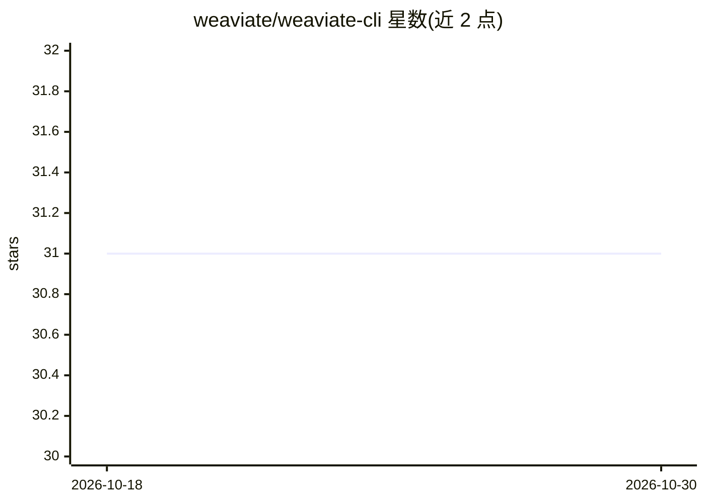

# weaviate/weaviate-cli

⭐ 31 · Python · BSD-3-Clause · 推送 2026-10-13 · [GitHub](https://github.com/weaviate/weaviate-cli) · 组织维护

**Weaviate 向量数据库的命令行管理工具**

Python 编写的 CLI，用于从终端管理 Weaviate 向量数据库实例：创建/更新/删除集合与租户，导入和查询数据（向量、关键词、混合搜索），备份与恢复（支持 S3、GCS、文件系统后端），监控分片，配置向量索引、副本与一致性级别，以及分配/撤销用户角色权限。通过 ~/.config/weaviate/config.json 配置集群端点与认证信息，支持多用户切换。要求 Python 3.10+ 和本地或远程 Weaviate 实例。

## 筛选速览

| 维度 | 判定 | 备注 |
|---|---|---|
| AI 角色 | `ai-ecosystem` | LLM/agent 周边工具 |
| 许可风险 | `permissive` | BSD-3-Clause |
| 部署形态 | `library` | 以包/库形式分发 |
| 模型依赖 | local-ok | 支持本地模型 |
| 硬件要求 | — | 无带数字的原话,不猜 |
| 安装摩擦 | `low` | 无编译、无系统依赖或容器化 |
| 成熟度 | — | 结构信号不足 |

## 能力要点

- 集合与多租户管理（创建/更新/删除、租户状态）
- 数据导入与向量/关键词/混合搜索查询
- 备份与恢复，支持 S3、GCS、文件系统后端
- 角色与权限的分配/撤销及多用户配置

## 适用场景

- 在终端批量管理 Weaviate 集合、租户与分片
- 对 Weaviate 数据做备份与恢复
- 为集群用户分配角色与权限

## 场景标签

`向量数据库` · 领域:知识与检索

## 证据(README 行号)

> L8: A powerful command-line interface for managing and interacting with Weaviate vector databases directly from your ter
> L12: - **Data Management**: Import, query, update and delete data with various search types (vector, keyword, hybrid)

## 星数曲线

2026-10-18 31 → 2026-10-30 31（+0）

---
*卡片 v1 · prompt 1.4 · 生成 2026-10-26 · 置信度 high · 依据 README sha `a5b9cc0715e2` · [字段定义](../../DATASET.md)*
