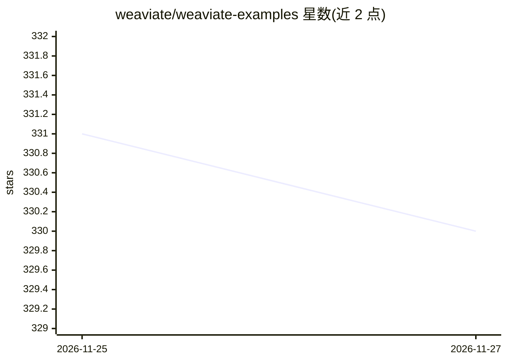

# weaviate/weaviate-examples

⭐ 330 · HTML · MIT · 推送 2026-11-23 · [GitHub](https://github.com/weaviate/weaviate-examples) · 组织维护

**Weaviate 向量数据库的示例与教程合集，面向学习者**

该仓库汇集 Weaviate 向量搜索引擎的示例与教程清单，以表格形式列出约 20 个项目，覆盖语义搜索、多模态文本/图像检索、问答、NER、图像分类、推荐系统及监控配置等主题，语言涉及 GraphQL、Python、JavaScript/NodeJs、Bash 及 Jupyter/Colab 笔记本。多数示例假设本地已按文档指南运行一个 Weaviate 实例；部分示例依赖特定向量化或 ML 模块，具体安装方式在各教程中说明。

## 筛选速览

| 维度 | 判定 | 备注 |
|---|---|---|
| AI 角色 | `ai-knowledge` | 知识聚合/清单类 |
| 许可风险 | `permissive` | MIT |
| 部署形态 | `None` |  |
| 模型依赖 | — | README 未给出锁定关系 |
| 硬件要求 | — | 无带数字的原话,不猜 |
| 安装摩擦 | `low` | 无编译、无系统依赖或容器化 |
| 成熟度 | — | 结构信号不足 |

## 能力要点

- 约 20 个覆盖语义搜索、多模态检索、问答、NER、图像分类、推荐的示例
- 支持 GraphQL、Python、JavaScript/NodeJs、Bash 等多种语言示例
- 含 ODSC East 2022 与 KGC 2022 的 workshop 笔记本
- 提供 Prometheus+Grafana 监控配置示例

## 适用场景

- 按教程学习 Weaviate 向量搜索与 Python 客户端入门
- 参考 Docker-compose 配置搭建带 NER/问答模块的演示数据集
- 为自己的语义搜索或多模态检索项目找示例代码

## 场景标签

`教程课程` `语义搜索` `多模态` `推荐系统` · 领域:知识与检索

## 证据(README 行号)

> L3: List of examples and tutorials of how to use the Vector Search Engine
> L12: ## Examples

## 星数曲线

2026-11-25 331 → 2026-11-27 330（-1）

---
*卡片 v1 · prompt 1.4 · 生成 2026-11-24 · 置信度 high · 依据 README sha `f9b2d693d439` · [字段定义](../../DATASET.md)*
