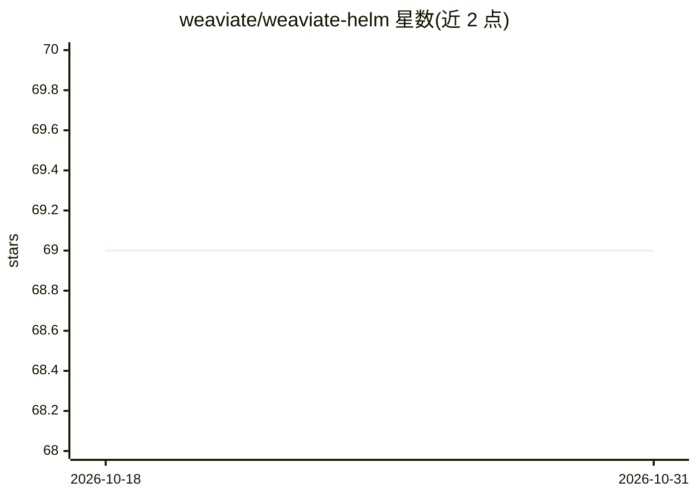

# weaviate/weaviate-helm

⭐ 69 · Shell · BSD-3-Clause · 推送 2026-08-26 · [GitHub](https://github.com/weaviate/weaviate-helm) · [官网](https://weaviate.io/developers/weaviate/current/) · 组织维护

**将 Weaviate 向量数据库部署到 Kubernetes 的 Helm chart**

Weaviate 官方维护的 Helm chart，用于在 Kubernetes 集群上部署 Weaviate。通过添加 chart 仓库并执行 helm install 完成安装。README 记录了 v1.25 迁移要求（podManagementPolicy 改为 Parallel 以支持 Raft 共识，升级前需删除 StatefulSet）以及 17.1.0 版本移除默认资源限制的变更，并附贡献者发布流程。

## 筛选速览

| 维度 | 判定 | 备注 |
|---|---|---|
| AI 角色 | `ai-ecosystem` | LLM/agent 周边工具 |
| 许可风险 | `permissive` | BSD-3-Clause |
| 部署形态 | `library` | 以包/库形式分发 |
| 模型依赖 | — | README 未给出锁定关系 |
| 硬件要求 | — | 无带数字的原话,不猜 |
| 安装摩擦 | `low` | 无编译、无系统依赖或容器化 |
| 成熟度 | — | 结构信号不足 |

## 能力要点

- 通过 helm repo add + helm install 部署 Weaviate 到 Kubernetes
- v1.25 起 podManagementPolicy 改为 Parallel 以引导 Raft 集群
- 17.1.0 起移除默认资源限制，由用户自行配置 requests/limits

## 适用场景

- 在 Kubernetes 集群上部署 Weaviate 向量数据库
- 升级旧版本 Weaviate 集群到 v1.25+ 并处理 StatefulSet 迁移
- 按系统情况定制模块的 CPU/内存资源配置

## 场景标签

`向量数据库` · 领域:知识与检索

## 证据(README 行号)

> L3: Helm chart for Weaviate application. Weaviate can be deployed to a Kubernetes cluster using this chart.
> L13: helm install my-weaviate weaviate/weaviate

## 星数曲线

2026-10-18 69 → 2026-10-31 69（+0）

---
*卡片 v1 · prompt 1.4 · 生成 2026-10-24 · 置信度 high · 依据 README sha `41aca181133d` · [字段定义](../../DATASET.md)*
