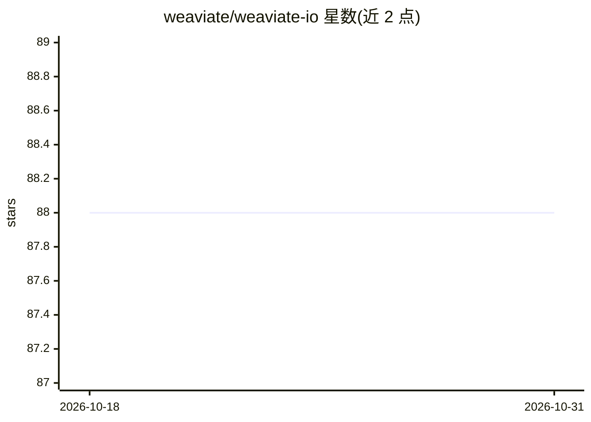

# weaviate/weaviate-io

⭐ 88 · MDX · 推送 2026-10-30 · [GitHub](https://github.com/weaviate/weaviate-io) · [官网](https://weaviate.io) · 组织维护

**Weaviate 向量数据库文档站的源码仓库（构建与贡献指南）**

存放 Weaviate 向量数据库文档网站的代码仓库，基于 Docusaurus 2 静态站点生成器与 Node.js/yarn 构建。README 说明本地构建流程：通过 nvm 安装 Node.js 20、npm 全局安装 yarn、克隆仓库后 yarn install 启动本地服务或生成静态站点，并可用 yarn deploy 部署到 GitHub Pages。文档正文已迁移至 weaviate/docs 仓库并上线 docs.weaviate.io，本仓库同时说明文档中代码示例的两种组织方式（从脚本抽取与纯文本标签页）。

## 筛选速览

| 维度 | 判定 | 备注 |
|---|---|---|
| AI 角色 | `ai-knowledge` | 知识聚合/清单类 |
| 许可风险 | `none` | — |
| 部署形态 | `library` | 以包/库形式分发 |
| 模型依赖 | — | README 未给出锁定关系 |
| 硬件要求 | — | 无带数字的原话,不猜 |
| 安装摩擦 | `low` | 无编译、无系统依赖或容器化 |
| 成熟度 | — | 结构信号不足 |

## 能力要点

- 基于 Docusaurus 2 与 Node.js/yarn 构建静态文档站
- 提供 yarn start 本地预览与 yarn build 静态生成（含链接检查）
- 代码示例通过自定义 FilteredTextBlock 组件从完整脚本中抽取
- 文档正文已迁移至 weaviate/docs 仓库

## 适用场景

- 为 Weaviate 文档站贡献修改或翻译
- 本地构建并预览文档网站
- 了解文档代码示例的编写与测试规范

## 场景标签

 · 领域:开发者文档/网站基础设施

## 证据(README 行号)

> L2: > The documentation for this project has been moved to a new repository: weaviate/docs.
> L7: Weaviate uses Docusaurus 2 to build our

## 星数曲线

2026-10-18 88 → 2026-10-31 88（+0）

---
*卡片 v1 · prompt 1.4 · 生成 2026-10-24 · 置信度 mid · 依据 README sha `d801a9ce565e` · [字段定义](../../DATASET.md)*
