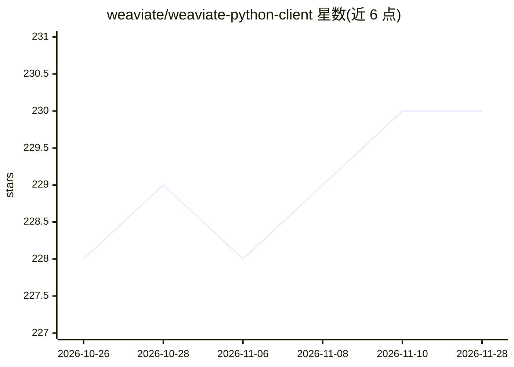

# weaviate/weaviate-python-client

⭐ 230 · Python · BSD-3-Clause · 推送 2026-11-27 · [GitHub](https://github.com/weaviate/weaviate-python-client) · [官网](https://weaviate.io/developers/weaviate/client-libraries/python) · 组织维护

**Weaviate 向量数据库的官方 Python 客户端库**

Weaviate 的 Python 原生客户端，用于与 Weaviate 实例交互，发布于 PyPI（包名 weaviate-client），提供官方文档、参考手册与社区支持渠道。要求 Python 3.11 及以上；4.X 版本处于活跃支持状态，3.X 已弃用、仅接收关键修复与依赖更新。README 本身较简短，具体 API 用法指向 weaviate.io 的官方文档与 ReadTheDocs 参考页。

## 筛选速览

| 维度 | 判定 | 备注 |
|---|---|---|
| AI 角色 | `ai-ecosystem` | LLM/agent 周边工具 |
| 许可风险 | `permissive` | BSD-3-Clause |
| 部署形态 | `library` | 以包/库形式分发 |
| 模型依赖 | — | README 未给出锁定关系 |
| 硬件要求 | — | 无带数字的原话,不猜 |
| 安装摩擦 | `low` | 无编译、无系统依赖或容器化 |
| 成熟度 | — | 结构信号不足 |

## 能力要点

- 与 Weaviate 实例交互的 Python 原生客户端
- 要求 Python 3.11 及以上版本
- 4.X 活跃支持，3.X 仅关键修复与依赖更新
- 提供 ReadTheDocs 参考文档与社区论坛支持

## 适用场景

- 在 Python 应用中读写 Weaviate 向量数据库
- 构建语义检索/向量搜索流程的客户端接入层
- 维护旧版 3.X 客户端的项目获取关键修复

## 场景标签

 · 领域:数据库/向量搜索基础设施

## 证据(README 行号)

> L19: A python native client for easy interaction with a Weaviate instance.
> L21: The client is tested for python 3.11 and higher.

## 星数曲线

2026-10-26 228 → 2026-11-28 230（+2）

---
*卡片 v1 · prompt 1.4 · 生成 2026-11-28 · 置信度 mid · 依据 README sha `3d73c815f099` · [字段定义](../../DATASET.md)*
