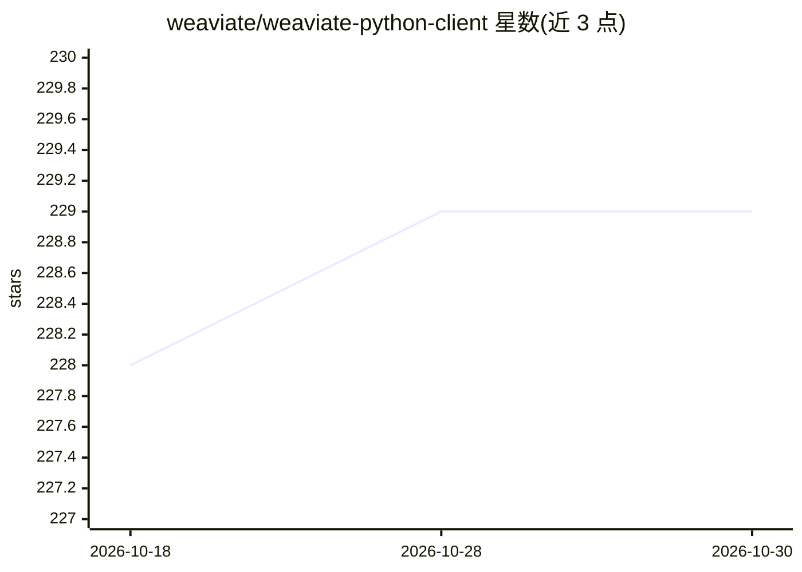

# weaviate/weaviate-python-client

⭐ 229 · Python · BSD-3-Clause · 推送 2026-10-28 · [GitHub](https://github.com/weaviate/weaviate-python-client) · [官网](https://weaviate.io/developers/weaviate/client-libraries/python) · 组织维护

**Weaviate 向量数据库的官方 Python 客户端库**

提供 Python 原生接口与 Weaviate 实例交互的客户端库，支持 Python 3.9 及以上版本。当前维护 4.X（积极支持）与 3.X（已弃用，仅接收关键修复与依赖更新）两个版本线。配套 ReadTheDocs 参考文档、社区论坛与 StackOverflow 支持渠道。README 未展示具体安装命令与功能细节，但 PyPI 徽章（L11-13）表明通过 weaviate-client 包分发。

## 筛选速览

| 维度 | 判定 | 备注 |
|---|---|---|
| AI 角色 | `ai-ecosystem` | LLM/agent 周边工具 |
| 许可风险 | `permissive` | BSD-3-Clause |
| 部署形态 | `library` | 以包/库形式分发 |
| 模型依赖 | — | README 未给出锁定关系 |
| 硬件要求 | — | 无带数字的原话,不猜 |
| 安装摩擦 | `low` | 无编译、无系统依赖或容器化 |
| 成熟度 | — | 结构信号不足 |

## 能力要点

- Python 原生客户端，用于与 Weaviate 实例交互
- 支持 Python 3.9 及以上版本
- 4.X 积极支持，3.X 仅接收关键修复

## 适用场景

- 在 Python 项目中连接并操作 Weaviate 向量数据库
- 构建语义搜索与向量检索应用
- 查阅官方文档与社区论坛获取使用支持

## 场景标签

`向量数据库` · 领域:知识与检索

## 证据(README 行号)

> L19: A python native client for easy interaction with a Weaviate instance.
> L21: The client is tested for python 3.9 and higher.

## 星数曲线

2026-10-18 228 → 2026-10-30 229（+1）

---
*卡片 v1 · prompt 1.4 · 生成 2026-10-22 · 置信度 high · 依据 README sha `3726de674f6a` · [字段定义](../../DATASET.md)*
