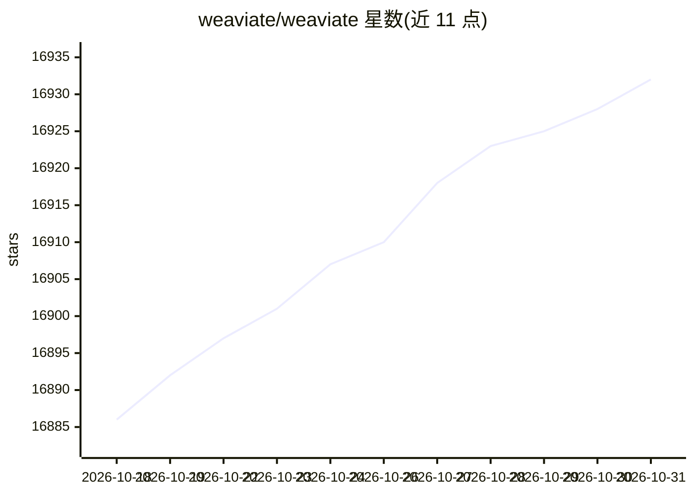

# weaviate/weaviate

⭐ 16,932 · Go · NOASSERTION · 推送 2026-10-30 · [GitHub](https://github.com/weaviate/weaviate) · [官网](https://weaviate.io/developers/weaviate/) · 组织维护

**面向开发者的开源向量数据库，支持语义搜索与 RAG**

用 Go 编写的云原生向量数据库，同时存储对象与向量，将向量相似搜索、关键词过滤、检索增强生成（RAG）与重排序整合在单一查询接口。支持导入时用集成模型自动向量化，或直接导入预计算向量；生产部署内置多租户、复制、RBAC 与向量压缩。通过 REST/gRPC/GraphQL API 访问，提供 Python、JavaScript/TypeScript、Java、Go、C# 等客户端库。许可为 BSD 3-Clause 加 wl/ 目录下的商业许可，企业功能需许可证密钥。

## 筛选速览

| 维度 | 判定 | 备注 |
|---|---|---|
| AI 角色 | `ai-ecosystem` | LLM/agent 周边工具 |
| 许可风险 | `dual` | NOASSERTION |
| 部署形态 | `self-host` | docker 或自建部署 |
| 模型依赖 | — | README 未给出锁定关系 |
| 硬件要求 | — | 无带数字的原话,不猜 |
| 安装摩擦 | `low` | 无编译、无系统依赖或容器化 |
| 成熟度 | — | 结构信号不足 |

## 动量与使用信号

- 维护:`active` — 距上次 push 1.7 天,年发版 100,161 位贡献者
- 涨星:近 1 天 **+0**(自 20261016 起算)
- 安装:npm 包 `skills` 月下载 23,786,800

## 能力要点

- 向量搜索、关键词过滤、RAG 与重排序在单一查询接口
- 导入时自动向量化（集成 OpenAI、Cohere、HuggingFace 等模型）或导入自有向量
- 内置多租户、复制、RBAC、向量压缩等生产特性
- 提供面向 Claude Code、Cursor 等 coding agent 的 Weaviate Agent Skills

## 适用场景

- 搭建 RAG 系统与问答机器人
- 对十亿级向量做语义搜索与混合搜索
- 构建推荐引擎与内容分类应用

## 场景标签

`向量数据库` `语义搜索` `推荐系统` · 领域:知识与检索

## 证据(README 行号)

> L9: **Weaviate** is a cloud-native vector database that stores both objects and vectors, enabling semantic search at sca
> L75: Weaviate exposes REST API, gRPC API, and GraphQL API to communicate with the database server.
> L146: |**LLM and Agent Frameworks**|Build agents and generative AI applications|Agno, Composio, CrewAI, DSPy, Dynamiq, H

## 星数曲线

2026-10-18 16,886 → 2026-10-31 16,932（+46）

---
*卡片 v1 · prompt 1.4 · 生成 2026-10-18 · 置信度 mid · 依据 README sha `a58a49eea174` · [字段定义](../../DATASET.md)*
