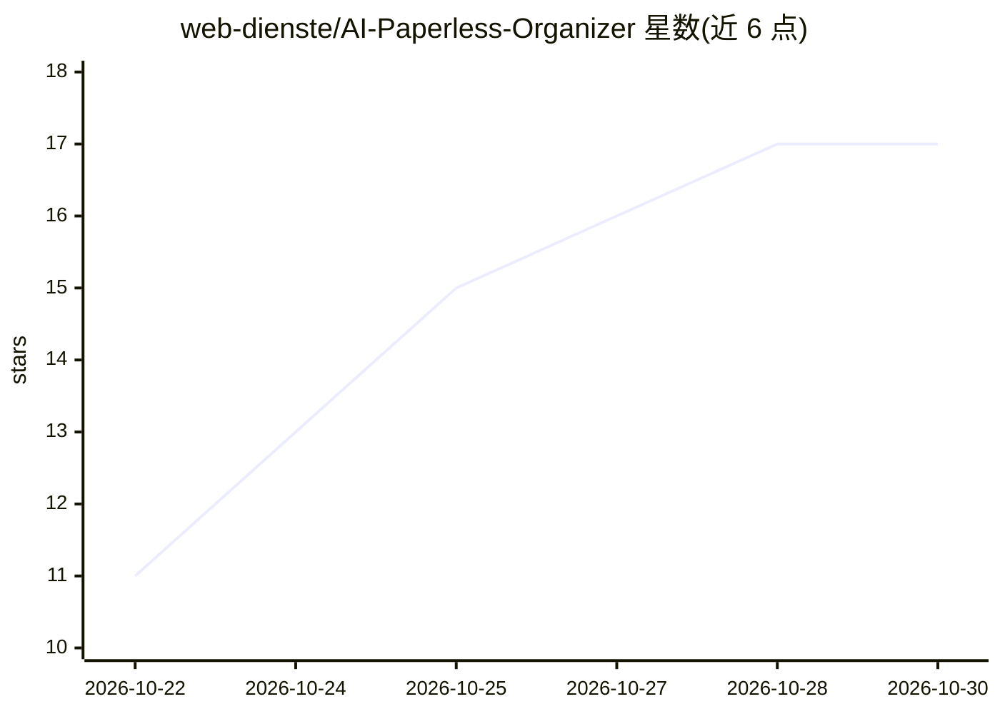

# web-dienste/AI-Paperless-Organizer

⭐ 17 · TypeScript · MIT · 推送 2026-10-27 · [GitHub](https://github.com/web-dienste/AI-Paperless-Organizer) · [官网](https://hub.docker.com/r/webdienste/ai-paperless-organizer) · 个人维护 · 中文 README

**Paperless-ngx 的本地 AI 维护工具：清理、分类、重 OCR 与归档问答**

面向已运行多年的 Paperless-ngx 归档的自托管 Web 应用：用 Ollama 本地模型或云 LLM 读取文档内容并自动填写标题/标签/往来单位/日期/自定义字段，合并重复的往来单位与标签，用本地视觉模型对扫描件重新 OCR，通过校验和、嵌入与发票号比对查找重复，并支持带来源引用的 RAG 归档问答与 Google Drive/OneDrive/Nextcloud 导入。带最多 4 个 LLM 提供商的基准测试。自述处于 Betatest，修改归档数据前需自行备份；无内置登录，限定内网/VPN 使用。

## 筛选速览

| 维度 | 判定 | 备注 |
|---|---|---|
| AI 角色 | `ai-native` | 本体是模型或模型工具 |
| 许可风险 | `permissive` | MIT |
| 部署形态 | `self-host` | docker 或自建部署 |
| 模型依赖 | local-ok | 支持本地模型 |
| 硬件要求 | — | 无带数字的原话,不猜 |
| 安装摩擦 | `low` | 无编译、无系统依赖或容器化 |
| 成熟度 | `idea` | |

## 能力要点

- AI 分类器自动填写标题、标签、往来单位、日期、存储路径与自定义字段（IBAN/发票号等）
- 基于 Ollama Vision 本地模型的重 OCR，含看护与批处理
- 重复往来单位/标签/文档类型检测与合并（附置信度，人工确认）
- 带来源引用与混合搜索的 RAG 归档问答，以及最多 4 个 LLM 提供商的基准对比

## 适用场景

- 清理多年积累的 Paperless-ngx 归档：合并重复往来单位、清理标签
- 用本地模型对识别质量差的扫描件重新 OCR
- 自动为存量未分类文档补齐元数据
- 直接向自己的文档归档提问并获取来源引用

## 场景标签

`OCR` `文档问答` · 领域:知识与检索

## 证据(README 行号)

> L3: **Räumt ein gewachsenes Paperless-ngx-Archiv auf – mit lokaler KI über Ollama oder einem Cloud-Anbieter**
> L48: |📷|**OCR (Ollama Vision)**|Bessere Texterkennung mit lokalen KI-Modellen, Watchdog, Batch-Verarbeitung|
> L54: |💬|**Dokumenten-Chat (RAG)**|Fragen an dein Archiv stellen – mit Quellenangabe und Hybrid-Search|

## 星数曲线

2026-10-22 11 → 2026-10-30 17（+6）

---
*卡片 v1 · prompt 1.4 · 生成 2026-10-29 · 置信度 high · 依据 README sha `3dfbf8cb5d3c` · [字段定义](../../DATASET.md)*
