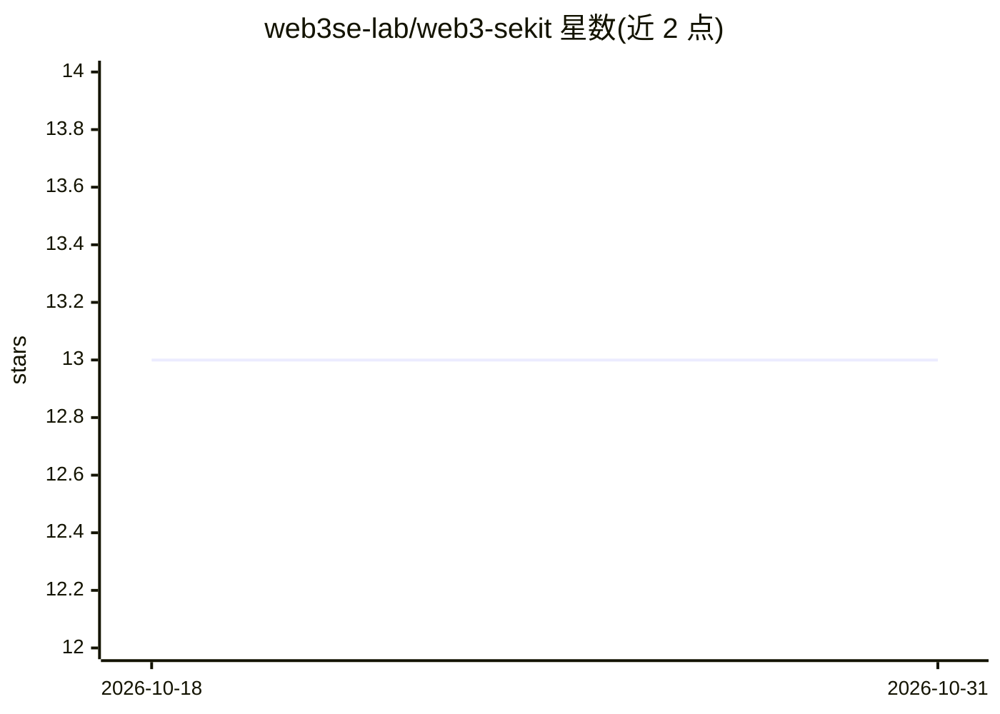

# web3se-lab/web3-sekit

⭐ 13 · JavaScript · MIT · 推送 2026-03-06 · [GitHub](https://github.com/web3se-lab/web3-sekit) · [官网](https://web3se-lab.github.io) · 组织维护

**智能合约恶意意图与漏洞检测的研究工具集**

面向 Web3 软件工程研究的工具集，核心提供 SmartBERT 与 SmartIntent 两个模型：SmartBERT 基于 BERT 预训练，将 Solidity 智能合约函数级代码编码为嵌入向量（MLM 训练于 16,000+ 真实合约）；SmartIntentNN 用深度神经网络检测合约中的恶意开发者意图，V1 基于 TensorFlow.js 与 Universal Sentence Encoder，V2 集成 SmartBERT。配套发布意图与漏洞标注数据集（HF 下载、MySQL 导入）、Web API 服务与数据爬取工具。安装需 Node.js v20+，通过 npm/yarn 安装依赖。

## 筛选速览

| 维度 | 判定 | 备注 |
|---|---|---|
| AI 角色 | `ai-native` | 本体是模型或模型工具 |
| 许可风险 | `permissive` | MIT |
| 部署形态 | `desktop` | 安装包/桌面程序 |
| 模型依赖 | — | README 未给出锁定关系 |
| 硬件要求 | — | 无带数字的原话,不猜 |
| 安装摩擦 | `low` | 无编译、无系统依赖或容器化 |
| 成熟度 | — | 结构信号不足 |

## 能力要点

- SmartBERT 将智能合约函数级代码编码为嵌入向量并提供 embed/tokenize API
- SmartIntentNN 检测智能合约中的恶意开发者意图，含意图高亮模型
- 含意图与漏洞标注数据集，通过 HTTP API 或 MySQL 数据库访问
- 提供 Web API 服务与训练/评估/预测脚本

## 适用场景

- 检测 Solidity 智能合约中的恶意意图（如 Honeypot、任意改费）
- 获取智能合约代码嵌入用于下游研究任务
- 使用公开数据集训练/评测意图与漏洞检测模型

## 场景标签

`模型训练` `网络安全` · 领域:学习与行业

## 证据(README 行号)

> L46: 🤩 **SmartIntentNN** is a deep neural network tool powered by Tensorflow.js.
> L65: - **SmartIntentNN V1** is trained and evaluated on **Tensorflow.js**.

## 星数曲线

2026-10-18 13 → 2026-10-31 13（+0）

---
*卡片 v1 · prompt 1.4 · 生成 2026-10-31 · 置信度 high · 依据 README sha `569e6bb822dd` · [字段定义](../../DATASET.md)*
