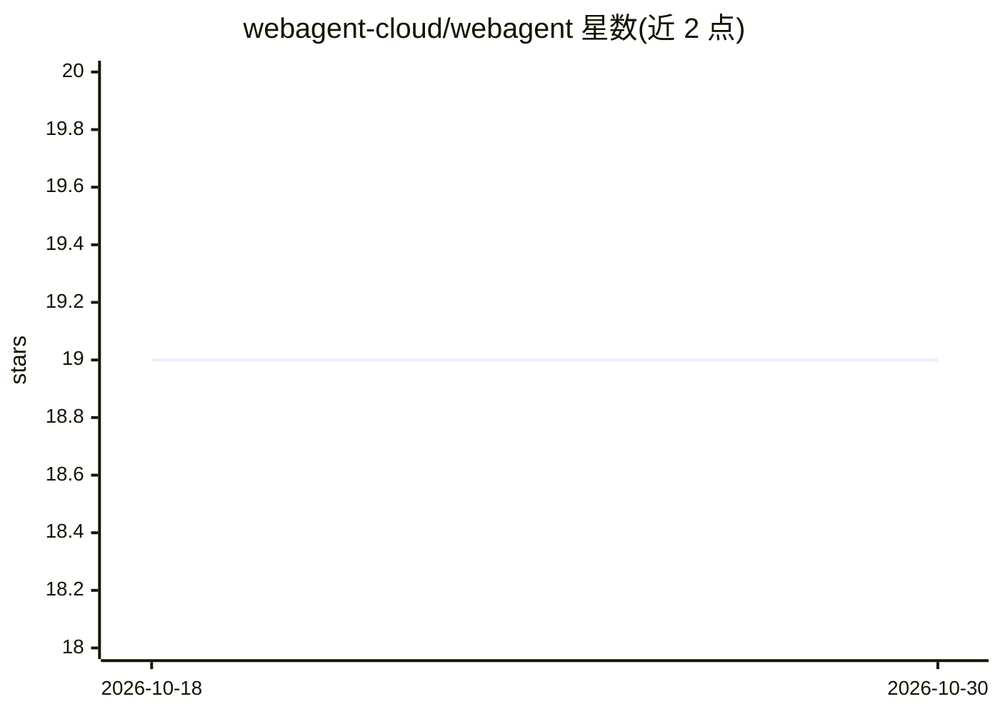

# webagent-cloud/webagent

⭐ 19 · Python · MIT · 推送 2026-05-02 · [GitHub](https://github.com/webagent-cloud/webagent) · [官网](https://webagent.cloud) · 组织维护

**自托管的 AI 浏览器自动化 Agent，用提示词构建可复用工作流**

WebAgent 是一个可自托管的 AI 浏览器代理服务：通过 API 接收自然语言提示词，驱动浏览器执行任务。其机制是首次执行时用 AI 记录并缓存浏览器操作，生成参数化工作流，之后重复任务可不调用 AI 直接回放；网站变化导致工作流失效时自动回退到 AI（自愈）。支持多 LLM、多浏览器来源（本地、Steel、Browserbase），可对接 Browser-use 等 agent 引擎，结果存储于数据库并可用 webhook 通知。提供本地 Python 安装与 Docker 两种部署方式。

## 筛选速览

| 维度 | 判定 | 备注 |
|---|---|---|
| AI 角色 | `ai-native` | 本体是模型或模型工具 |
| 许可风险 | `permissive` | MIT |
| 部署形态 | `self-host` | docker 或自建部署 |
| 模型依赖 | — | README 未给出锁定关系 |
| 硬件要求 | — | 无带数字的原话,不猜 |
| 安装摩擦 | `low` | 无编译、无系统依赖或容器化 |
| 成熟度 | — | 结构信号不足 |

## 能力要点

- 记录并缓存浏览器操作生成参数化工作流，回放时无需 AI 调用
- 工作流自愈：网站变化时回退到 AI 执行
- 支持多种浏览器来源（本地、Steel、Browserbase）与多 LLM
- 提供 HTTP API 及 n8n、Zapier、Make 集成，结果经 webhook 通知

## 适用场景

- 用自然语言让 AI 在网页上执行重复性任务
- 把浏览器自动化能力通过 API 集成到自己的应用或 n8n/Zapier 流程
- 在自有基础设施上自托管浏览器自动化服务

## 场景标签

`浏览器自动化` `工作流自动化` · 领域:效率与自动化

## 证据(README 行号)

> L3: 🚀 Build fast and reliable AI browser agents !
> L17: - 🚀 Webagent can record and cache browser actions to build parameterized workflows, then replay repetitive tasks wi

## 星数曲线

2026-10-18 19 → 2026-10-30 19（+0）

---
*卡片 v1 · prompt 1.4 · 生成 2026-10-28 · 置信度 high · 依据 README sha `6371fa3528fe` · [字段定义](../../DATASET.md)*
