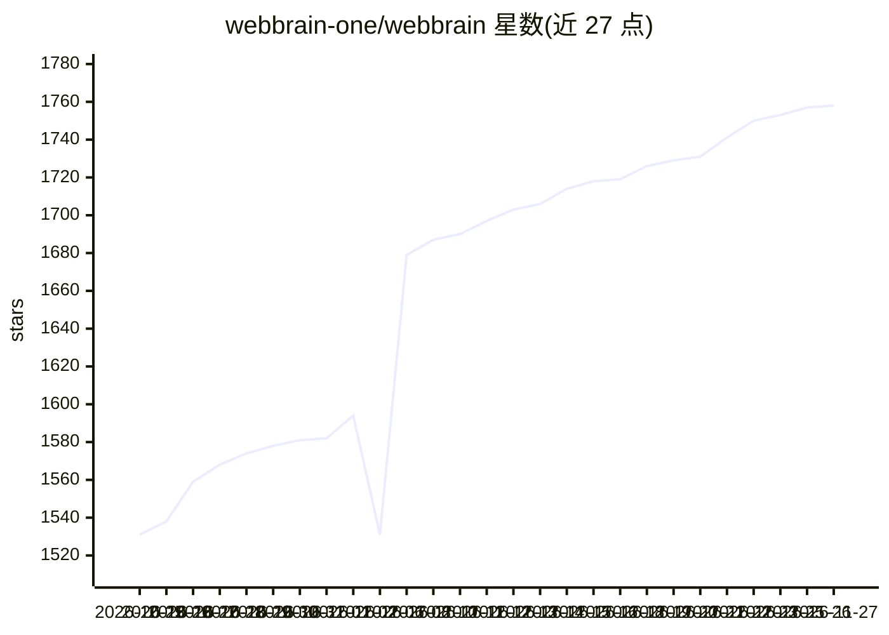

# webbrain-one/webbrain

⭐ 1,758 · JavaScript · NOASSERTION · 推送 2026-11-26 · [GitHub](https://github.com/webbrain-one/webbrain) · [官网](https://webbrain.one) · 组织维护

**面向浏览器用户的 AI agent 扩展：读页、操作与多步工作流**

WebBrain 是运行在 Chrome/Firefox/Edge 侧边栏的浏览器 AI agent 扩展：通过无障碍树读取页面文本、表单、PDF 等内容，支持点击、输入、导航、上传下载等页面操作，可执行最长 195 步的多步工具循环，并可将成功运行保存为可复用工作流。模型后端可选托管默认模型、本地 llama.cpp/Ollama 等 OpenAI 兼容服务器，或 129 张内置云服务商卡片。提供 Ask/Act/Dev 三种权限模式、按站点的操作权限提示与上下文自动压缩。通过商店安装或源码加载。

## 筛选速览

| 维度 | 判定 | 备注 |
|---|---|---|
| AI 角色 | `ai-native` | 本体是模型或模型工具 |
| 许可风险 | `none` | NOASSERTION |
| 部署形态 | `library` | 以包/库形式分发 |
| 模型依赖 | local-ok | 支持本地模型 |
| 硬件要求 | — | 无带数字的原话,不猜 |
| 安装摩擦 | `low` | 无编译、无系统依赖或容器化 |
| 成熟度 | — | 结构信号不足 |

## 能力要点

- Ask/Act/Dev 三模式权限控制，重要操作前有按站点权限提示
- 支持本地 llama.cpp/Ollama/vLLM 等 OpenAI 兼容服务器与 129 张内置云服务商卡片
- 多步 agent 循环（默认 130 步，可配置至 195 步）与保存工作流、定时任务、页面监视
- Vision 模式以截图坐标执行操作，基于无障碍树读取页面

## 适用场景

- 让 AI 总结当前页面或提取页面中的链接信息
- 自动化填写表单、导航等多步浏览器操作流程
- 将成功的自动化运行保存为可复用、可分享的工作流
- 定时监视页面变化并在满足条件时触发操作

## 场景标签

`浏览器自动化` · 领域:效率与自动化

## 证据(README 行号)

> L5:  Open-source AI browser agent for chatting with pages, automating tasks, and running multi-step workflows with your 
> L26: type, and navigate its way through. It runs on the model you choose — a local
> L66: |**Ask**|Read-only. Reads the page, answers questions, fetches URLs.|

## 星数曲线

2026-10-25 1,531 → 2026-11-27 1,758（+227）

---
*卡片 v1 · prompt 1.4 · 生成 2026-11-26 · 置信度 mid · 依据 README sha `4fe8b20d6d3e` · [字段定义](../../DATASET.md)*
