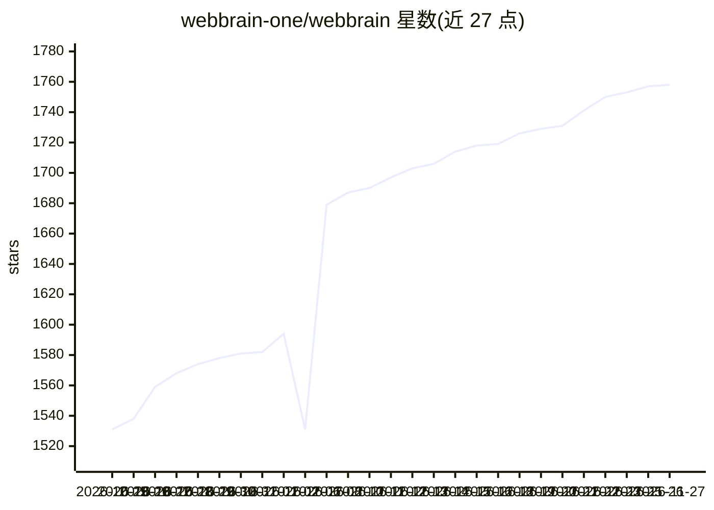

# webbrain-one/webbrain

⭐ 1,758 · JavaScript · NOASSERTION · 推送 2026-11-26 · [GitHub](https://github.com/webbrain-one/webbrain) · [官网](https://webbrain.one) · 组织维护 · 中文 README

**浏览器 AI agent 扩展：在侧栏读页面、操作网页、跑多步任务**

WebBrain 是面向 Chrome/Firefox/Edge 的浏览器扩展，在侧栏提供 AI agent：读取当前页面并回答问题，或代替用户点击、输入、导航、填表、上传下载，执行最多可配置 195 步的多步工具循环。提供 Ask/Act/Dev 三种权限模式与逐站权限确认。模型可选：托管默认模型（无需 key）、本地 llama.cpp/Ollama/vLLM 等 OpenAI 兼容服务器，或 129 张内置云 API provider 卡（Chromium 上）。支持保存工作流、定时任务、/watch 页面轮询、技能加载与 token 感知的上下文自动压缩。从商店安装或从源码加载 unpacked 扩展；永久安装 Firefox 版需签名。

## 筛选速览

| 维度 | 判定 | 备注 |
|---|---|---|
| AI 角色 | `ai-native` | 本体是模型或模型工具 |
| 许可风险 | `none` | NOASSERTION |
| 部署形态 | `library` | 以包/库形式分发 |
| 模型依赖 | local-ok | 支持本地模型 |
| 硬件要求 | — | 无带数字的原话,不猜 |
| 安装摩擦 | `low` | 无编译、无系统依赖或容器化 |
| 成熟度 | — | 结构信号不足 |

## 能力要点

- Ask/Act/Dev 三模式权限控制与逐站操作确认
- 接入 llama.cpp/Ollama/vLLM 等本地服务器与 129 张云 API provider 卡
- 多步 agent 循环（可配置至 195 步）与 Vision 截图坐标操作模式
- 保存工作流、/schedule 定时任务与 /watch 条件轮询

## 适用场景

- 在侧栏让 AI 总结当前页面、提取链接与表格
- 让 agent 自动填表、点击、在多个页面间执行多步操作
- 用本地模型在浏览器里跑隐私可控的 AI 任务
- 用 /watch 轮询页面并在条件满足时触发动作

## 场景标签

`浏览器自动化` `聊天机器人` · 领域:效率与自动化

## 证据(README 行号)

> L24: WebBrain is a web browser extension that puts an AI agent in a side panel next to
> L26: type, and navigate its way through. It runs on the model you choose — a local
> L126: Settings → Models → LLM ships **129 built-in provider cards on Chromium** (128 on Firefox),

## 星数曲线

2026-10-25 1,531 → 2026-11-27 1,758（+227）

---
*卡片 v1 · prompt 1.4 · 生成 2026-11-27 · 置信度 mid · 依据 README sha `a9933b620568` · [字段定义](../../DATASET.md)*
