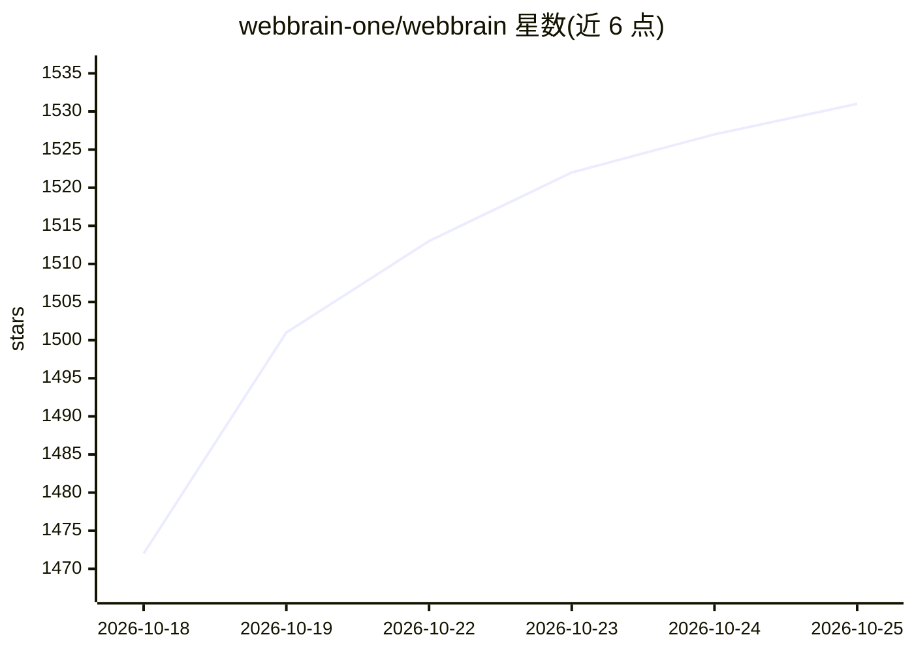

# webbrain-one/webbrain

⭐ 1,531 · JavaScript · NOASSERTION · 推送 2026-10-22 · [GitHub](https://github.com/webbrain-one/webbrain) · [官网](https://webbrain.one) · 组织维护 · 中文 README

**浏览器侧边栏 AI agent 扩展：对话操作网页与多步任务**

面向终端用户的 Chrome/Firefox/Edge 浏览器扩展，在侧边栏中提供 AI agent：可读取页面（经无障碍树）、回答问题，并以点击、输入、导航等方式执行浏览器任务。支持三档模式（Ask 只读、Act 操作、Dev 含页面源码与调试），提供计划审批、最多 195 步的多步 agent 循环、可保存/复用的工作流、定时任务与页面监控（/schedule、/watch）及斜杠命令集。模型可选本地 llama.cpp/Ollama/vLLM 等 OpenAI 兼容服务器，或 OpenAI、Anthropic、Gemini 等云 API，共 112 张内置 provider 卡。限制：Firefox 版因缺少 DevTools 协议等价物，无 shadow-DOM 穿透与 CDP 截图等功能。

## 筛选速览

| 维度 | 判定 | 备注 |
|---|---|---|
| AI 角色 | `ai-native` | 本体是模型或模型工具 |
| 许可风险 | `none` | NOASSERTION |
| 部署形态 | `library` | 以包/库形式分发 |
| 模型依赖 | local-ok | 支持本地模型 |
| 硬件要求 | — | 无带数字的原话,不猜 |
| 安装摩擦 | `low` | 无编译、无系统依赖或容器化 |
| 成熟度 | — | 结构信号不足 |

## 能力要点

- 经无障碍树读取页面（文本/链接/表格/PDF），Act 模式执行点击/输入/上传/下载
- Plan-before-Act 计划审批、最多 195 步的多步 agent 循环
- 工作流保存/复用、/schedule 定时任务、/watch 页面条件监控
- 支持本地 llama.cpp/Ollama/vLLM 及 OpenAI/Anthropic/Gemini 等 112 张 provider 卡

## 适用场景

- 在侧边栏里让 AI 总结当前页面或查找页面信息
- 用自然语言让 agent 代填表单、搜索、下载等浏览器操作
- 把成功运行保存为可复用工作流，或定时/监控页面条件触发任务
- 接入本地 Ollama/llama.cpp 模型，在不发 API key 的情况下使用

## 场景标签

`浏览器自动化` `AI 助手` · 领域:效率与自动化

## 证据(README 行号)

> L5:  Open-source AI browser agent for chatting with pages, automating tasks, and running multi-step workflows with your 
> L21: WebBrain is a web browser extension that puts an AI agent in a side panel next to
> L109: **Cloud APIs** — OpenAI, Anthropic Claude, Google Gemini, Azure OpenAI, AWS

## 星数曲线

2026-10-18 1,472 → 2026-10-25 1,531（+59）

---
*卡片 v1 · prompt 1.4 · 生成 2026-10-21 · 置信度 mid · 依据 README sha `7cb9d86b2486` · [字段定义](../../DATASET.md)*
