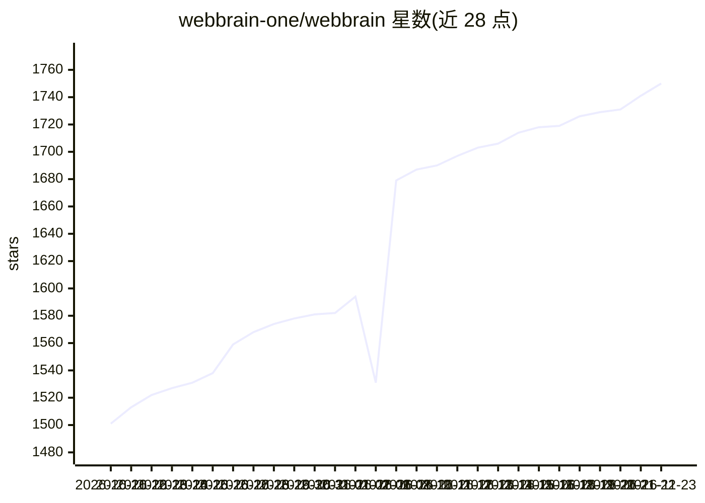

# webbrain-one/webbrain

⭐ 1,750 · JavaScript · NOASSERTION · 推送 2026-11-21 · [GitHub](https://github.com/webbrain-one/webbrain) · [官网](https://webbrain.one) · 组织维护 · 中文 README

**浏览器扩展型 AI agent：读页、问答与多步任务自动化**

WebBrain 是面向 Chrome、Firefox、Edge 的开源浏览器扩展，在侧边栏提供 AI agent：读取当前页面文本、链接、表单、PDF（经可访问性树），并可点击、输入、导航、上传下载，以 Ask/Act/Dev 三种模式限制 agent 权限。支持 Ask/Act/Dev 三种模式控制权限、Vision 截图模式、最多 195 步的多步工具循环、可复用工作流、定时与轮询任务、技能系统、分标签页对话与本地记忆。模型可自选：托管默认模型、125 张内置云端 provider 卡，或指向任意 OpenAI 兼容的本地服务器（llama.cpp/Ollama/vLLM 等）。安装来自三家应用商店或源码加载；Firefox 永久安装需签名。

## 筛选速览

| 维度 | 判定 | 备注 |
|---|---|---|
| AI 角色 | `ai-native` | 本体是模型或模型工具 |
| 许可风险 | `none` | NOASSERTION |
| 部署形态 | `library` | 以包/库形式分发 |
| 模型依赖 | local-ok | 支持本地模型 |
| 硬件要求 | — | 无带数字的原话,不猜 |
| 安装摩擦 | `low` | 无编译、无系统依赖或容器化 |
| 成熟度 | — | 结构信号不足 |

## 能力要点

- Ask/Act/Dev 三模式控制 agent 权限，提供结构化 Act 前置计划审批
- 多步 agent 循环上限可配（默认 130 步，最大 195 步），支持保存与复用工作流
- 经可访问性树读取页面，Vision 模式按截图坐标操作
- 内置 125 张 provider 卡（Chromium），并支持 llama.cpp/Ollama/vLLM 等本地服务器与桌面端 Companion 应用

## 适用场景

- 在浏览器里对当前页面提问、总结、提取链接
- 让 agent 代为填表、点击、跨页执行多步流程
- 用本地模型跑一个不依赖云 API 的浏览器 agent
- 定时/轮询监控页面变化并自动执行动作

## 场景标签

`浏览器自动化` · 领域:效率与自动化

## 证据(README 行号)

> L5:  Open-source AI browser agent for chatting with pages, automating tasks, and running multi-step workflows with your 
> L24: WebBrain is a web browser extension that puts an AI agent in a side panel next to
> L153: - **Multi-step agent** — autonomous tool-use loop, configurable up to 195 steps

## 星数曲线

2026-10-21 1,501 → 2026-11-23 1,750（+249）

---
*卡片 v1 · prompt 1.4 · 生成 2026-11-23 · 置信度 mid · 依据 README sha `d3a9deff9953` · [字段定义](../../DATASET.md)*
