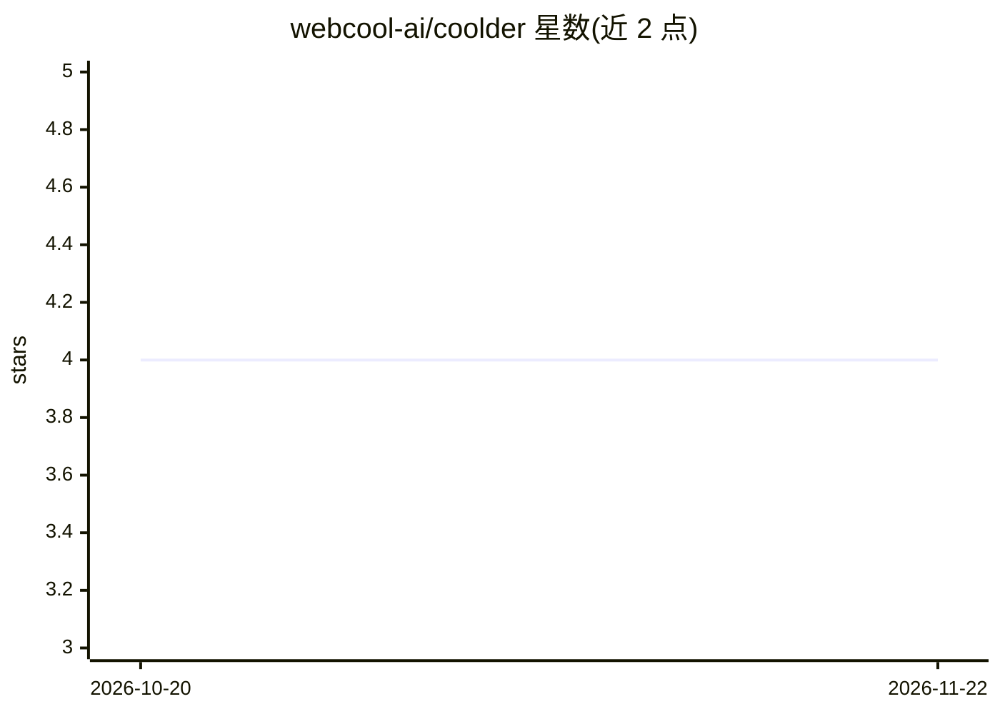

# webcool-ai/coolder

⭐ 4 · C++ · MIT · 推送 2026-10-15 · [GitHub](https://github.com/webcool-ai/coolder) · [官网](https://webcool.cn/) · 个人维护 · 中文 README

**本地部署的浏览器版 AI 编程智能体工作台**

用 C++17 编写的编程智能体应用，将大模型接入、项目上下文、代码工具、构建验证与变更审核整合为同一工作台：用户以自然语言提交任务，智能体读取/搜索源码、生成多文件修订，在隔离草稿中构建验证并据诊断修复，修订经差异审核后才写入正式项目。支持多账户与策略管理、检查点恢复、上下文压缩，并提供 C/Java/Python/Rust 等多语言绑定与 Android/iOS 打包。需从源码编译，模型须自行配置外部服务端点，本身不内置模型权重。

## 筛选速览

| 维度 | 判定 | 备注 |
|---|---|---|
| AI 角色 | `ai-native` | 本体是模型或模型工具 |
| 许可风险 | `permissive` | MIT |
| 部署形态 | `None` |  |
| 模型依赖 | local-ok | 支持本地模型 |
| 硬件要求 | — | 无带数字的原话,不猜 |
| 安装摩擦 | `high` | 编译与系统依赖俱全 |
| 成熟度 | — | 结构信号不足 |

## 能力要点

- ReAct 风格模型-工具循环，结合构建检查与自动修复
- AI 修订先入修订区，支持差异预览与逐项/批量审核写入
- 多协议接入：OpenAI compatible、Anthropic、Gemini、Ollama 等
- 提供 libai 核心的 C、Java、Python、Rust 等多语言绑定

## 适用场景

- 导入已有项目，用自然语言实现增量功能并审核差异
- 结合编译诊断迭代修复编译错误与缺陷
- 为团队搭建多账户本地智能体开发环境
- 将 libai 链接到其他 C++ 宿主做编程智能体二次开发

## 场景标签

`编码 Agent` · 领域:编码与开发

## 证据(README 行号)

> L5: **Coolder 是一个本地部署、通过浏览器使用的 AI 编程智能体。** 它将大模型、项目上下文、代码操作工具、构建验证和变更审核整合到同一个工作台，让用户以自然语言描述需求，在真实项目中完成代码理解、功能开发、问题修复和迭代维
> L17: - **多模型接入**：支持 OpenAI compatible、OpenAI Chat、OpenAI Responses、Anthropic、Gemini 和 Ollama 协议。
> L228: 管理员可以配置多个模型服务的协议、Base URL、模型 ID 和 API Key，启用模型并测试连接。API Key 由 libai 加密保存，列表接口不回传密钥。使用 Ollama 等本地服务时仍需配置相应端点和模型，Coo

## 星数曲线

2026-10-20 4 → 2026-11-22 4（+0）

---
*卡片 v1 · prompt 1.4 · 生成 2026-11-21 · 置信度 high · 依据 README sha `a1d6c18e16f3` · [字段定义](../../DATASET.md)*
