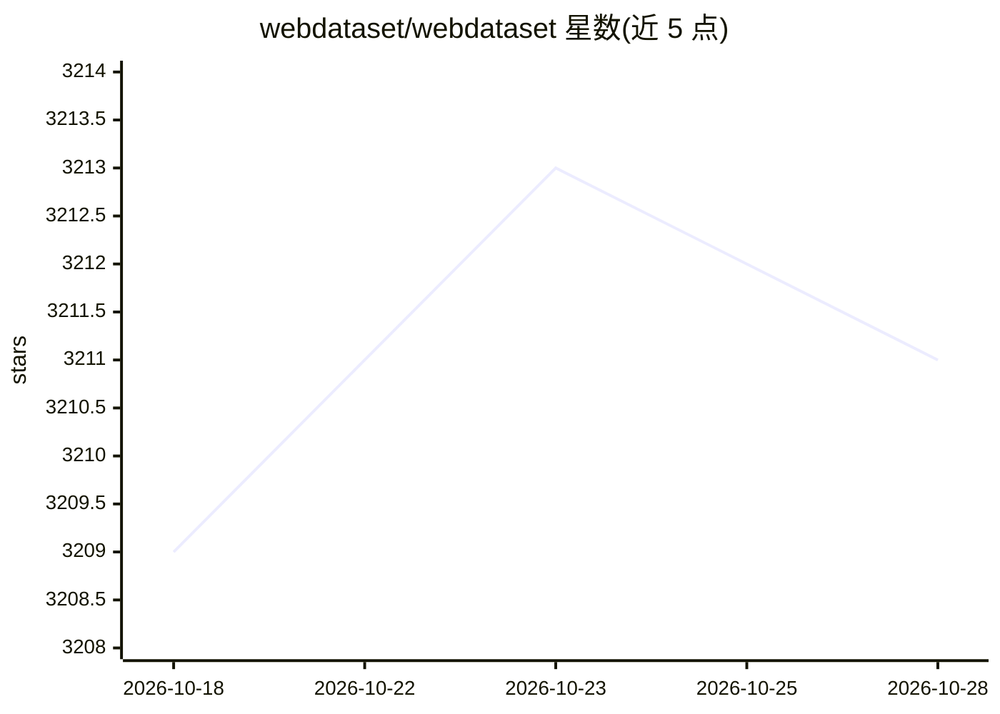

# webdataset/webdataset

⭐ 3,211 · Python · BSD-3-Clause · 推送 2026-02-09 · [GitHub](https://github.com/webdataset/webdataset) · 个人维护

**面向深度学习训练的顺序 I/O 数据加载库（tar 分片格式）**

WebDataset 是基于 tar 分片的 Python I/O 库，实现 PyTorch IterableDataset 接口，可配合 PyTorch、Tensorflow、Jax 使用。通过纯顺序读取（本地磁盘或管道/对象存储）加载大规模训练数据，支持分片并行访问、shuffle、解码、缓存与流式数据增强管道；提供 fluid 与 pipeline 两种接口。限制：IterableDataset 生态支持较少，固定 epoch 的多节点样本均衡需借助 shard resampling。另提供 Secure Mode 禁用 pipe/file 协议与 pickle 解码。

## 筛选速览

| 维度 | 判定 | 备注 |
|---|---|---|
| AI 角色 | `ai-ecosystem` | LLM/agent 周边工具 |
| 许可风险 | `permissive` | BSD-3-Clause |
| 部署形态 | `library` | 以包/库形式分发 |
| 模型依赖 | — | README 未给出锁定关系 |
| 硬件要求 | — | 无带数字的原话,不猜 |
| 安装摩擦 | `low` | 无编译、无系统依赖或容器化 |
| 成熟度 | — | 结构信号不足 |

## 能力要点

- tar 分片顺序读取，支持本地盘与云对象存储/管道输入
- 实现 PyTorch IterableDataset，兼容 DataLoader 并行加载
- fluid 与 DataPipeline 两种流式管道接口
- Secure Mode 可禁用 pipe:/file: 协议与 pickle 解码

## 适用场景

- 大规模图像分类或 LLM 训练的高吞吐数据加载
- 从云对象存储直接流式读取训练数据，无需本地存储
- 构建 shard 级 shuffle、解码与增强的数据管道

## 场景标签

 · 领域:深度学习/数据基础设施

## 证据(README 行号)

> L22: The WebDataset representation allows writing purely sequential I/O pipelines for large scale deep learning. This is
> L68: The `webdataset` library is an implementation of PyTorch `IterableDataset` (or a mock implementation thereof if you

## 星数曲线

2026-10-18 3,209 → 2026-10-28 3,211（+2）

---
*卡片 v1 · prompt 1.4 · 生成 2026-10-20 · 置信度 high · 依据 README sha `56a9a07dd8a0` · [字段定义](../../DATASET.md)*
