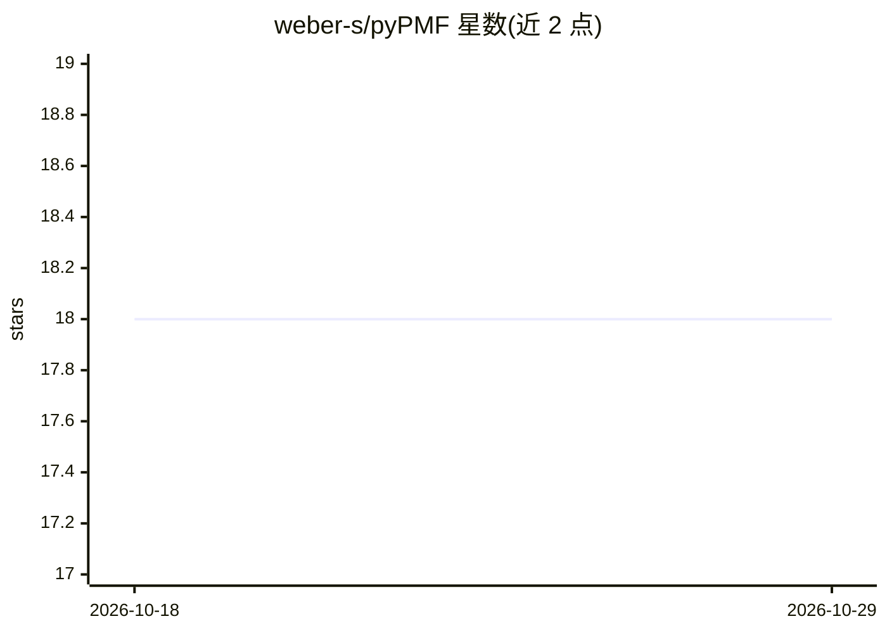

# weber-s/pyPMF

⭐ 18 · Python · 推送 2026-03-06 · [GitHub](https://github.com/weber-s/pyPMF) · 个人维护

**读取 EPA PMF5 输出并做后处理与绘图的 Python 库**

面向大气科学研究者的 Positive Matrix Factorization（PMF）结果处理工具：将 EPA PMF5 软件输出的 xlsx 或 SQL 数据库文件读取为 pandas DataFrame/Python 对象，便于后续计算。内置绘图功能，覆盖化学组分谱（绝对/归一化）、因子物种分配、时间序列贡献、Bootstrap 与 DISP 不确定性、季节贡献、污染日来源贡献等。作者因博士课题需批量运行 PMF 并计算结果而开发。目前仅支持 EPA PMF5 数据格式。

## 筛选速览

| 维度 | 判定 | 备注 |
|---|---|---|
| AI 角色 | `ai-ecosystem` | LLM/agent 周边工具 |
| 许可风险 | `none` | — |
| 部署形态 | `library` | 以包/库形式分发 |
| 模型依赖 | — | README 未给出锁定关系 |
| 硬件要求 | — | 无带数字的原话,不猜 |
| 安装摩擦 | `low` | 无编译、无系统依赖或容器化 |
| 成熟度 | — | 结构信号不足 |

## 能力要点

- 读取 EPA PMF5 的 xlsx 或 sql 数据库输出并映射为 Python 对象
- 化学谱、因子分配、时间序列等内置绘图工具
- Bootstrap 与 DISP 不确定性绘图
- 源自作者博士课题的批量 PMF 结果处理需求

## 适用场景

- 将 EPA PMF5 的 xlsx 输出整理为 DataFrame 便于计算
- 绘制 PMF 因子谱图与时间序列贡献图
- 对污染日与正常日的来源贡献进行对比分析

## 场景标签

`数据分析` `科研工具` · 领域:效率与自动化

## 证据(README 行号)

> L4: Positive Matrix Factorization in python
> L9: Currently, only data from the EPA PMF5 is handle, from `xlsx` or sql database output.
> L20: Since I needed to plot the results afterward, I also added some plot utilities in this

## 星数曲线

2026-10-18 18 → 2026-10-29 18（+0）

---
*卡片 v1 · prompt 1.4 · 生成 2026-10-29 · 置信度 mid · 依据 README sha `20325a8974c4` · [字段定义](../../DATASET.md)*
