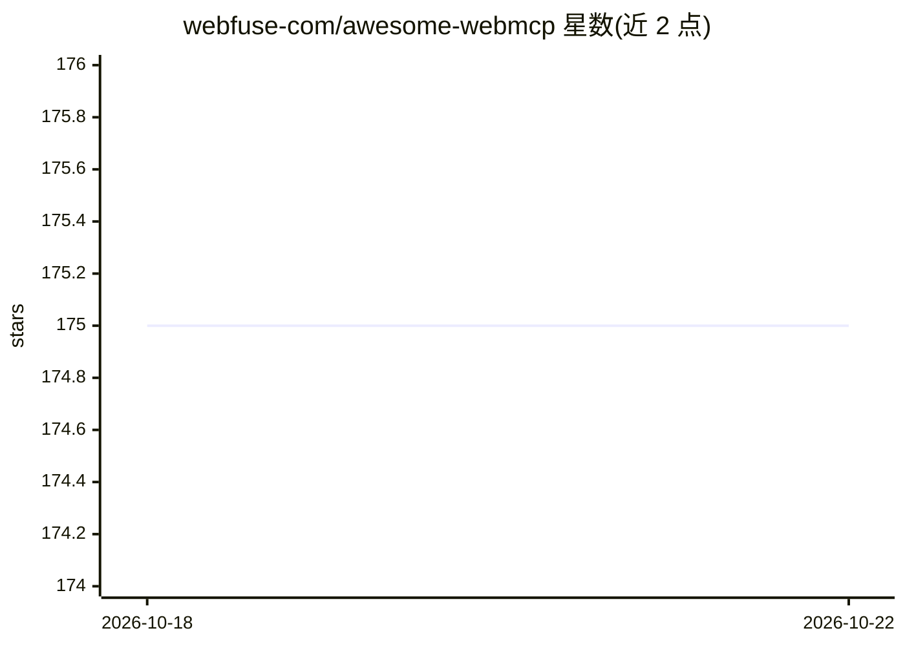

# webfuse-com/awesome-webmcp

⭐ 175 · 推送 2026-10-09 · [GitHub](https://github.com/webfuse-com/awesome-webmcp) · [官网](https://www.reddit.com/r/WebMCP_Developers/) · 个人维护

**WebMCP（W3C 浏览器标准）资源策展清单：规范、库、工具与示例**

围绕 WebMCP 标准（网站通过 navigator.modelContext 向浏览器内 AI agent 暴露结构化 JavaScript 工具）的策展清单，收录 W3C 规范文档、Chrome 146+ 启用方法、MCP-B 生态库与 npm polyfill 包、独立 SDK、GoogleChromeLabs 与社区示例站点、开发调试工具、WindTunnel 基准、视频演讲与社区入口，按类别组织条目并附简介链接。面向尝试接入该标准的 Web 开发者与 agent 开发者。仅 Chrome Canary/Beta 146+ 且需开启实验 flag。

## 筛选速览

| 维度 | 判定 | 备注 |
|---|---|---|
| AI 角色 | `ai-knowledge` | 知识聚合/清单类 |
| 许可风险 | `none` | — |
| 部署形态 | `None` |  |
| 模型依赖 | — | README 未给出锁定关系 |
| 硬件要求 | — | 无带数字的原话,不猜 |
| 安装摩擦 | `low` | 无编译、无系统依赖或容器化 |
| 成熟度 | — | 结构信号不足 |

## 能力要点

- 收录 W3C 社区组规范、Chrome 146+ 启用指南与官方工具
- 聚合 MCP-B npm 包、React hooks、polyfill 等库与 SDK
- 汇集官方与社区 WebMCP 示例站点及调试/审计工具
- 含 WindTunnel 基准与 MCP 生态关联资源

## 适用场景

- 查找 WebMCP 规范与上手教程
- 为项目挑选 WebMCP 库、SDK 或 polyfill
- 寻找示例站点与调试工具验证自己的接入

## 场景标签

 · 领域:Web 标准/AI agent 基础设施

## 证据(README 行号)

> L10: **The browser standard that lets any website expose structured JavaScript tools directly to in-browser AI agents vi
> L20: - WebMCP Spec (W3C Community Group Draft) - Full IDL, tool registration, schemas, and security model.

## 星数曲线

2026-10-18 175 → 2026-10-22 175（+0）

---
*卡片 v1 · prompt 1.4 · 生成 2026-10-22 · 置信度 high · 依据 README sha `a27cd7cf1219` · [字段定义](../../DATASET.md)*
