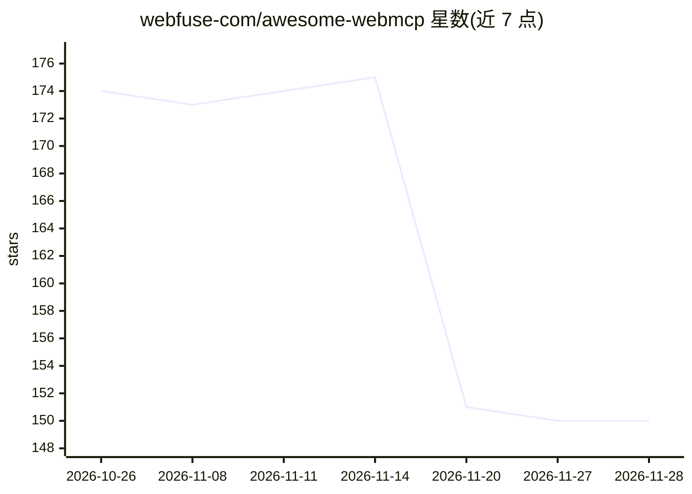

# webfuse-com/awesome-webmcp

⭐ 150 · 推送 2026-11-27 · [GitHub](https://github.com/webfuse-com/awesome-webmcp) · [官网](https://www.reddit.com/r/WebMCP_Developers/) · 组织维护

**WebMCP W3C 标准相关资源策展清单：规范、教程、库与示例**

由 Web Machine Learning Community Group 维护的 Awesome 清单，围绕 WebMCP W3C 草案标准（网站经 navigator.modelContext 向浏览器内 AI agent 暴露结构化 JavaScript 工具）聚合资源：官方规范与文档、浏览器 flag 开启方式、调试扩展、声明式与命令式 API 教程、Polyfill 与 SDK 库、可实测的官方与社区示例站点，以及开发者工具。内容为条目链接式目录，不含可安装的主体软件本身。

## 筛选速览

| 维度 | 判定 | 备注 |
|---|---|---|
| AI 角色 | `ai-knowledge` | 知识聚合/清单类 |
| 许可风险 | `none` | — |
| 部署形态 | `None` |  |
| 模型依赖 | — | README 未给出锁定关系 |
| 硬件要求 | — | 无带数字的原话,不猜 |
| 安装摩擦 | `low` | 无编译、无系统依赖或容器化 |
| 成熟度 | — | 结构信号不足 |

## 能力要点

- 聚合 W3C 草案规范、Chrome 146+ 预览说明与使用指南
- 收录 Polyfill、React hooks、Next.js 插件等库与 SDK 条目
- 官方与社区示例站点可配合 inspector 扩展实测
- 涵盖调试检查器、CLI 工具等开发者工具条目

## 适用场景

- 为网站接入 WebMCP 工具注册查找教程与 SDK
- 查找可实测 WebMCP 的浏览器扩展与调试工具
- 了解浏览器内 AI agent 工具生态的现有实现

## 场景标签

`精选清单` `教程课程` · 领域:学习与行业

## 证据(README 行号)

> L3: # Awesome WebMCP
> L22: - Awesome WebMCP (Official) - Curated list maintained by the Web Machine Learning Community Group.
> L10: **The browser standard that lets any website expose structured JavaScript tools directly to in-browser AI agents vi

## 星数曲线

2026-10-26 174 → 2026-11-28 150（-24）

---
*卡片 v1 · prompt 1.4 · 生成 2026-11-28 · 置信度 high · 依据 README sha `be754daa6e6e` · [字段定义](../../DATASET.md)*
