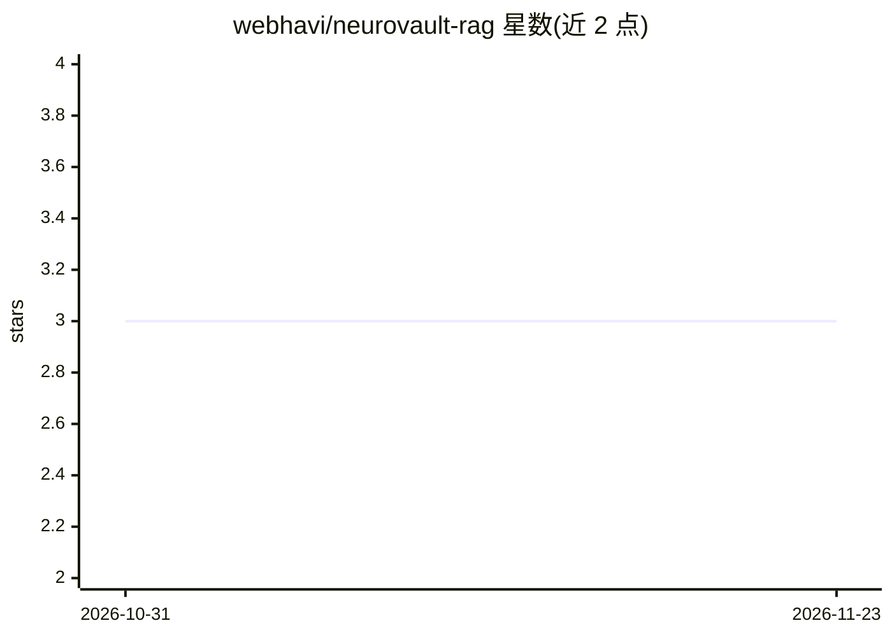

# webhavi/neurovault-rag

⭐ 3 · TypeScript · MIT · 推送 2026-11-18 · [GitHub](https://github.com/webhavi/neurovault-rag) · [官网](https://neurovault-rag.vercel.app) · 个人维护

**对 PDF/Markdown 文档提问的 3D 可视化 RAG 问答实验室**

以 FastAPI + React + Three.js 构建的检索增强问答应用：上传 PDF、Markdown 或文本文件后后台切块并向量化入 ChromaDB，提问时经 9 阶段检索管线（嵌入、向量搜索、MMR 重排）生成仅基于检索片段、带文件页码来源的答案；答案无出处时明确拒答。384 维嵌入经 PCA 投影到可旋转的 3D 空间。LLM key 存于浏览器（BYOK），无 key 时进入降级模式，文档索引与向量搜索仍可用。Windows 提供一键脚本，各平台可手动搭建。

## 筛选速览

| 维度 | 判定 | 备注 |
|---|---|---|
| AI 角色 | `ai-native` | 本体是模型或模型工具 |
| 许可风险 | `permissive` | MIT |
| 部署形态 | `library` | 以包/库形式分发 |
| 模型依赖 | — | README 未给出锁定关系 |
| 硬件要求 | — | 无带数字的原话,不猜 |
| 安装摩擦 | `low` | 无编译、无系统依赖或容器化 |
| 成熟度 | — | 结构信号不足 |

## 能力要点

- 仅基于已索引文档回答并附文件、页码与预览的来源引用
- 384 维嵌入经 PCA 投影至可交互 3D 空间，实时显示余弦相似度
- BYOK：API key 存于浏览器 localStorage，不经服务器存储
- 9 阶段检索管线在 UI 中展示各阶段实测耗时

## 适用场景

- 对本地 PDF 讲义或文档提问并获得带出处的答案
- 直观查看嵌入向量在 3D 空间中的分布与检索结果
- 无 LLM key 时仍进行文档索引与向量搜索探索

## 场景标签

`RAG` `文档问答` · 领域:知识与检索

## 证据(README 行号)

> L5:  A 3D + 2D, interactive Retrieval-Augmented Generation (RAG) lab.
> L64: |Answers come only from retrieved chunks, with file, page and preview.|An interactive 3D neural network explains da
> L326: |`POST`|`/api/chat`|Grounded RAG answer. Body: `{"question": "...", "byok_api_key": "...", "byok_provider": "groq"

## 星数曲线

2026-10-31 3 → 2026-11-23 3（+0）

---
*卡片 v1 · prompt 1.4 · 生成 2026-11-22 · 置信度 high · 依据 README sha `a6a51e103062` · [字段定义](../../DATASET.md)*
