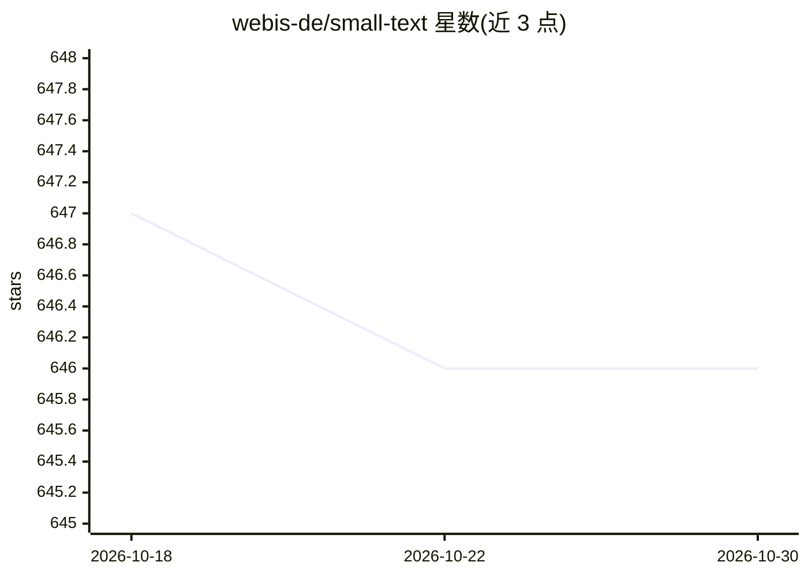

# webis-de/small-text

⭐ 646 · Python · MIT · 推送 2026-10-19 · [GitHub](https://github.com/webis-de/small-text) · [官网](https://small-text.readthedocs.io/) · 组织维护

**文本分类的主动学习 Python 库：高效标注少量数据训练模型**

small-text 提供文本分类场景下的主动学习框架：内置 19 种查询策略（v2.0.0）、5 种初始化策略与停止准则，可自由组合搭建主动学习实验或应用。提供统一接口，分类器可接入 sklearn、PyTorch 或 transformers 模型；支持 GPU 但不强制，CPU-only 场景仅需轻量安装与最小依赖。面向需要以少量标注数据训练文本分类器的 NLP 研究者与开发者，附带示例与 Colab notebooks，引入论文发表于 EACL 2023（获 Best System Demonstration）。

## 筛选速览

| 维度 | 判定 | 备注 |
|---|---|---|
| AI 角色 | `ai-native` | 本体是模型或模型工具 |
| 许可风险 | `permissive` | MIT |
| 部署形态 | `library` | 以包/库形式分发 |
| 模型依赖 | — | README 未给出锁定关系 |
| 硬件要求 | `cpu-ok` | |
| 安装摩擦 | `medium` | 含编译或系统依赖之一 |
| 成熟度 | `idea` | |

## 能力要点

- 内置 19 种查询策略、5 种初始化策略与停止准则，可混搭组合
- 统一接口接入 sklearn / PyTorch / transformers 分类器
- GPU 支持可选，CPU-only 场景轻量安装、最小依赖
- 可结合 Argilla 提供标注用户界面

## 适用场景

- 标注预算有限时高效构建文本分类训练集
- 系统性文献综述、社交媒体分类等研究中的加速标注
- 用 SetFit 零样本能力做主动学习冷启动初始化

## 场景标签

 · 领域:NLP/机器学习

## 证据(README 行号)

> L17: Small-Text provides state-of-the-art **Active Learning** for Text Classification.
> L40: - Provides unified interfaces for Active Learning, allowing you to
> L41:  easily mix and match query strategies with classifiers provided by sklearn, PyTorch, or transformers.

## 星数曲线

2026-10-18 647 → 2026-10-30 646（-1）

---
*卡片 v1 · prompt 1.4 · 生成 2026-10-21 · 置信度 high · 依据 README sha `024aeba7ce3a` · [字段定义](../../DATASET.md)*
