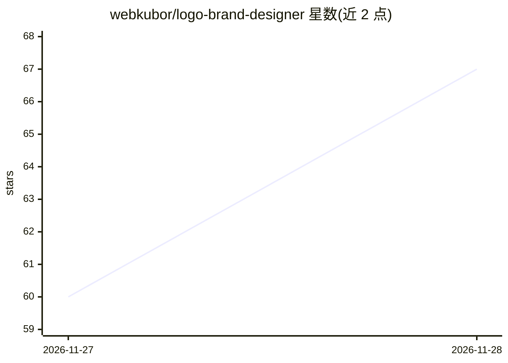

# webkubor/logo-brand-designer

⭐ 67 · Python · MIT · 推送 2026-11-27 · [GitHub](https://github.com/webkubor/logo-brand-designer) · [官网](https://webkubor.github.io/logo-brand-designer/) · 个人维护 · 中文 README

**给零基础用户的 Logo 设计 agent skill：从轮廓到验收交付品牌标识**

安装在 Codex/Claude Code 等 Agent Skills 工具中的 Logo 设计技能：用户描述产品，按三步流程交付——先比较黑白剪影定外轮廓并保存源文件，再在同一轮廓上做深浅背景配色并记录色值与渐变定义，最后渲染验收透明画布、留白与小尺寸可辨性，交付透明底 1:1 SVG、设计 token、浏览器图标与离线评审页。离线评审页生成器仅依赖 Python 3.9+ 标准库，可通过 npx 或 install.sh 安装，README 附带自有项目与社区案例的标识清单。

## 筛选速览

| 维度 | 判定 | 备注 |
|---|---|---|
| AI 角色 | `ai-native` | 本体是模型或模型工具 |
| 许可风险 | `permissive` | MIT |
| 部署形态 | `library` | 以包/库形式分发 |
| 模型依赖 | — | README 未给出锁定关系 |
| 硬件要求 | — | 无带数字的原话,不猜 |
| 安装摩擦 | `low` | 无编译、无系统依赖或容器化 |
| 成熟度 | — | 结构信号不足 |

## 能力要点

- 三步流程：黑白轮廓定形→深浅背景定色→实际渲染验收
- 交付设计 token、透明底 1:1 SVG、浏览器图标与离线评审页
- 离线评审页生成器仅依赖 Python 3.9+ 标准库
- 提供官网、社区作品展台与作品提交机制

## 适用场景

- 给新项目从零设计一枚透明底 SVG Logo
- 为已有标识做配色重构并在深浅底、小尺寸下验收
- 整理并公开团队的品牌资产清单与设计理念

## 场景标签

 · 领域:设计/品牌工具

## 证据(README 行号)

> L3: **给零基础用户的 Logo 设计技能。** 告诉 Codex 或 Claude Code 你的产品做什么，就能一步步选轮廓、选配色，拿到有辨识度的透明底 SVG、浏览器图标和评审页。
> L73: > 用 logo-brand-designer 给我的项目设计 Logo。先看产品和现有品牌资料，给我几种黑白轮廓。选定形态后，保留原轮廓做配色，再给我看深浅背景和小尺寸的效果。

## 星数曲线

2026-11-27 60 → 2026-11-28 67（+7）

---
*卡片 v1 · prompt 1.4 · 生成 2026-11-27 · 置信度 high · 依据 README sha `a18fafe63709` · [字段定义](../../DATASET.md)*
