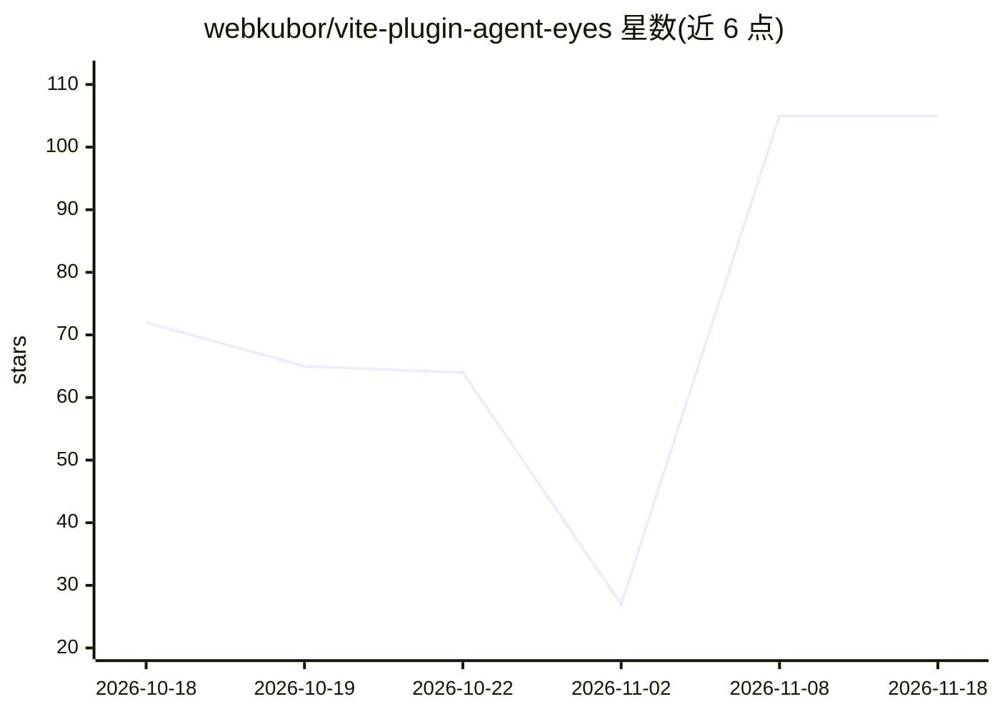

# webkubor/vite-plugin-agent-eyes

⭐ 105 · TypeScript · MIT · 推送 2026-11-17 · [GitHub](https://github.com/webkubor/vite-plugin-agent-eyes) · [官网](https://webkubor.github.io/vite-plugin-agent-eyes/) · 个人维护 · 中文 README

**Vite 遥测插件：让 AI agent 读取网站运行时错误与日志**

面向 Vite 项目的开发期插件：将运行时错误、API 请求、交互与代理层日志写成结构化线索，并在网页右下角提供可视化面板；启动横幅列出环境、代理目标、别名与技术栈；agentProxy() 记录 Cookie 链路并修复本地 HTTP 开发环境的 Domain/Secure/SameSite 问题；agentGit() 提供提交前 Guard，含环境文件分叉硬拦与设计 token 硬编码检查。支持 React、Vue、Svelte、Solid 与原生 JS，CI 验证 Vite 4–8。截图与日志仅在 dev 生效，Chrome 截图需浏览器开放 CDP。

## 筛选速览

| 维度 | 判定 | 备注 |
|---|---|---|
| AI 角色 | `ai-ecosystem` | LLM/agent 周边工具 |
| 许可风险 | `permissive` | MIT |
| 部署形态 | `library` | 以包/库形式分发 |
| 模型依赖 | — | README 未给出锁定关系 |
| 硬件要求 | — | 无带数字的原话,不猜 |
| 安装摩擦 | `low` | 无编译、无系统依赖或容器化 |
| 成熟度 | — | 结构信号不足 |

## 能力要点

- 结构化错误、API、交互与代理层日志供 agent 读取
- agentProxy() 记录 Cookie 链路并修复本地开发环境 Cookie 属性
- agentGit() 提交前 Guard：环境文件分叉拦截与设计 token 检查
- 网页可视化面板与带项目、路由、时间标记的截图

## 适用场景

- 让 AI agent 排查正在运行的网站错误而不用反复截图解释
- 本地开发时排查 401 等 Cookie/代理链路问题
- 提交前拦截环境文件分叉与硬编码颜色

## 场景标签

`LLM 可观测性` · 领域:评测与运维

## 证据(README 行号)

> L5: **让 AI agent 看见正在运行的网站。** 运行时错误、接口、路由和页面截图落成可读线索；人打开网页就能看见可视化面板。
> L26: |复现错误后翻散落的 console 和网络请求|结构化错误、API、交互与代理层日志留给 agent 自己读|

## 星数曲线

2026-10-18 72 → 2026-11-18 105（+33）

---
*卡片 v1 · prompt 1.4 · 生成 2026-11-17 · 置信度 high · 依据 README sha `d19b97959cb0` · [字段定义](../../DATASET.md)*
