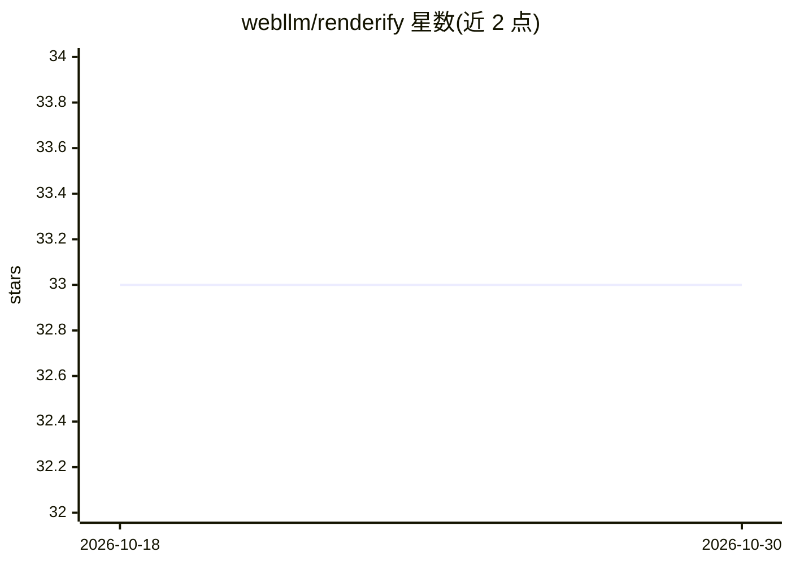

# webllm/renderify

⭐ 33 · TypeScript · MIT · 推送 2026-10-07 · [GitHub](https://github.com/webllm/renderify) · [官网](https://webllm.github.io/renderify) · 组织维护

**浏览器端运行时渲染 LLM 生成的 JSX/TSX，无需构建步骤**

面向 LLM 聊天/Agent 平台的前端渲染运行时：接收模型输出的 JSX/TSX 或结构化 RuntimePlan，经 @babel/standalone 内联转译与 JSPM CDN 模块解析后在浏览器直接渲染，无需后端编译与部署。执行前有安全策略检查（4 档 profile、模块白名单、执行预算），支持流式渐进渲染、React 生态兼容桥（映射到 preact/compat）与 MCP Apps 适配器；LLM 本身可选，也可作为纯渲染器接入自有模型管线。限制：仅支持浏览器 ESM 兼容子集，Node 内建模块与不支持方案会被拒绝。

## 筛选速览

| 维度 | 判定 | 备注 |
|---|---|---|
| AI 角色 | `ai-ecosystem` | LLM/agent 周边工具 |
| 许可风险 | `permissive` | MIT |
| 部署形态 | `library` | 以包/库形式分发 |
| 模型依赖 | local-ok | 支持本地模型 |
| 硬件要求 | — | 无带数字的原话,不猜 |
| 安装摩擦 | `low` | 无编译、无系统依赖或容器化 |
| 成熟度 | — | 结构信号不足 |

## 能力要点

- 零构建：@babel/standalone + JSPM 运行时转译与模块解析
- 执行前安全策略检查（strict/balanced/trusted/relaxed 四档）
- 结构化 RuntimePlan 与原始 TSX/JSX 双输入路径，LLM 可选
- @renderify/llm 内置 OpenAI/Anthropic/Google/Ollama/LM Studio 提供方

## 适用场景

- 聊天平台把模型输出即时渲染成可交互仪表盘或表单
- Agent 工具链动态生成操作界面而非纯文本回复
- 自然语言描述意图后秒级生成可运行 UI 原型
- 通过 MCP Apps 适配器在协议宿主中展示离线 RuntimePlan

## 场景标签

 · 领域:LLM 应用前端/生成式 UI

## 证据(README 行号)

> L11: > Renderify is a runtime-first, bundleless dynamic renderer that lets LLMs produce real, interactive UI on the fly.
> L62: - **Zero-build rendering**: LLM-generated JSX/TSX runs directly in the browser via `@babel/standalone` + JSPM CDN. 
> L68: - **LLM is optional**: You can use Renderify as a renderer-only runtime by supplying RuntimePlan/source from your o

## 星数曲线

2026-10-18 33 → 2026-10-30 33（+0）

---
*卡片 v1 · prompt 1.4 · 生成 2026-10-25 · 置信度 high · 依据 README sha `5f0b4a11528f` · [字段定义](../../DATASET.md)*
