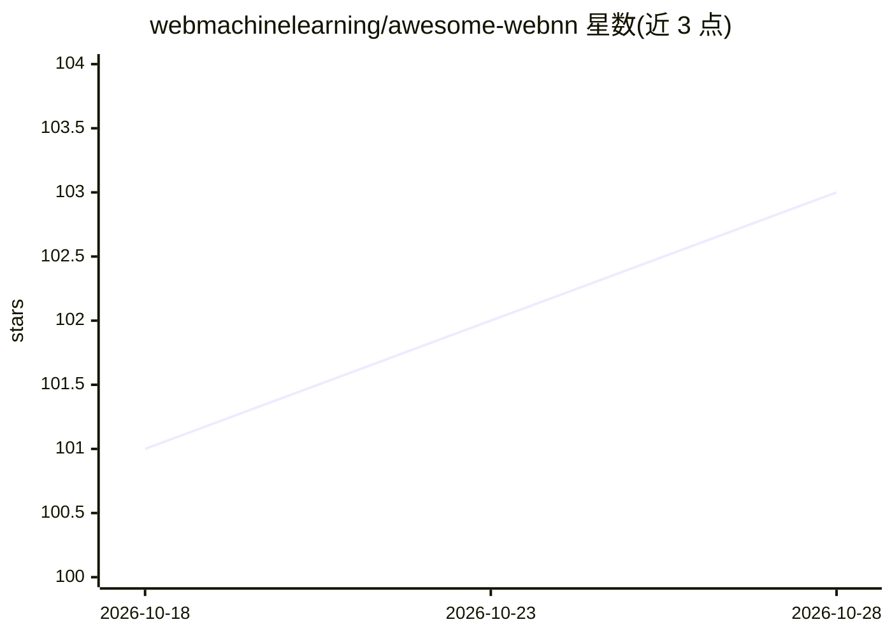

# webmachinelearning/awesome-webnn

⭐ 103 · CC0-1.0 · 推送 2026-10-28 · [GitHub](https://github.com/webmachinelearning/awesome-webnn) · 组织维护 · 中文 README

**WebNN 生态资源策展清单：文章/教程/演示/工具聚合**

围绕 W3C Web Neural Network (WebNN) API 的策展清单，收录文章、博客、演讲、视频、教程、浏览器支持数据、示例演示（图像分类、Stable Diffusion、Whisper 等）、框架（ONNX Runtime Web、Transformers.js、LiteRT.js）、模型转换与代码生成工具及相关网站。面向在浏览器中做端侧深度学习推理的 Web 开发者。条目以链接列表形式组织，仓库本身无可安装产物，采用 CC0 许可。

## 筛选速览

| 维度 | 判定 | 备注 |
|---|---|---|
| AI 角色 | `ai-knowledge` | 知识聚合/清单类 |
| 许可风险 | `viral` | CC0-1.0 |
| 部署形态 | `None` |  |
| 模型依赖 | — | README 未给出锁定关系 |
| 硬件要求 | — | 无带数字的原话,不猜 |
| 安装摩擦 | `low` | 无编译、无系统依赖或容器化 |
| 成熟度 | — | 结构信号不足 |

## 能力要点

- 覆盖文章/博客/演讲/视频/教程等多类 WebNN 资源
- 收录 CPU/GPU/NPU 上运行的官方演示与纯 WebNN API 示例
- 聚合 ONNX→WebNN 模型转换与代码生成工具
- 包含浏览器支持数据（CanIUse、算子实现状态）

## 适用场景

- 查找 WebNN API 的入门教程与规范入口
- 为浏览器端 AI 项目挑选支持 WebNN 的框架与运行时
- 了解 WebNN 浏览器实现进度与硬件加速现状

## 场景标签

`精选清单` · 领域:学习与行业

## 证据(README 行号)

> L3: > A curated list of _awesome_ things related to the Web Neural Network (WebNN) API.
> L7: Web Neural Network (WebNN) API is a new web standard that allows web apps and frameworks to accelerate deep neural n

## 星数曲线

2026-10-18 101 → 2026-10-28 103（+2）

---
*卡片 v1 · prompt 1.4 · 生成 2026-10-23 · 置信度 high · 依据 README sha `3b9a594dedfd` · [字段定义](../../DATASET.md)*
