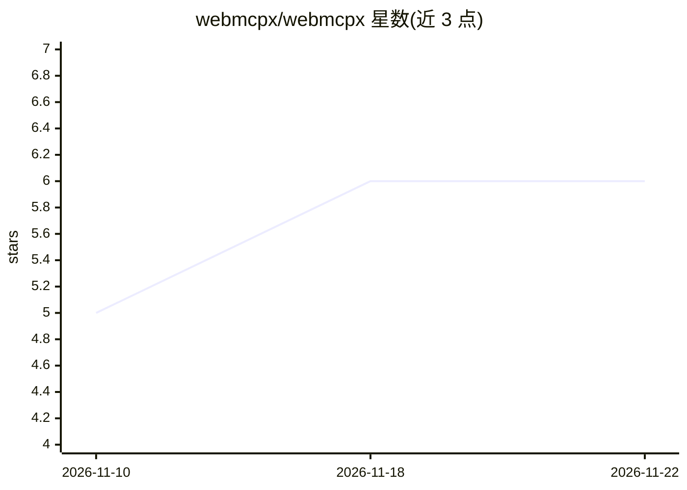

# webmcpx/webmcpx

⭐ 6 · TypeScript · MIT · 推送 2026-11-10 · [GitHub](https://github.com/webmcpx/webmcpx) · [官网](https://webmcpx.dev) · 组织维护 · 中文 README

**给网站接入 WebMCP 工具、给 agent 提供 MCP 桥接的工具集**

webmcpx 包含四部分：一段 script 标签（Loader）为页面注册 search_page、fetch_as_markdown、get_page_context 等标准工具并在缺失 WebMCP 的浏览器加载 W3C polyfill；一个 MCP server（npx webmcpx mcp）以无头浏览器打开页面，把页面工具以 MCP 工具形式交给 Claude Code、Codex、Cursor 等 MCP 客户端；一个 Rust 编写的 linter（crates.io / cargo install）检查 registerTool() 调用；以及站点扫描器与基准测试（6 站点、30 题、6 模型，按事实确定性评分）。README 记录个别站点上 token 消耗反而更多。

## 筛选速览

| 维度 | 判定 | 备注 |
|---|---|---|
| AI 角色 | `ai-ecosystem` | LLM/agent 周边工具 |
| 许可风险 | `permissive` | MIT |
| 部署形态 | `library` | 以包/库形式分发 |
| 模型依赖 | — | README 未给出锁定关系 |
| 硬件要求 | — | 无带数字的原话,不猜 |
| 安装摩擦 | `low` | 无编译、无系统依赖或容器化 |
| 成熟度 | `idea` | |

## 能力要点

- script 标签为页面注册三个只读标准工具并按需加载 W3C polyfill
- MCP server（npx webmcpx mcp）把页面 WebMCP 工具暴露给 MCP 客户端
- webmcpx lint 检查 registerTool() 调用（隐藏字符、legacy API 等）
- 自带基准：对比有/无 WebMCP 的 token 消耗，确定性评分

## 适用场景

- 为网站添加 agent 可调用的工具并通过扫描获得 agent-ready 徽章
- 让编码 agent 在打开的网页上调用页面工具以减少 token
- 自定义页面动作工具（表单声明式或 JS/react/vue/svelte）
- 用 linter 和扫描器检查页面工具质量

## 场景标签

`模型评测` · 领域:评测与运维

## 证据(README 行号)

> L203: |**Agent bridge** · `npx webmcpx mcp`|An MCP server for Claude Code, Codex, Cursor and others: it opens pages in a
> L223: **Is WebMCP the same as MCP?** No. WebMCP borrows MCP's tool model, but it is a browser API: the tools live

## 星数曲线

2026-11-10 5 → 2026-11-22 6（+1）

---
*卡片 v1 · prompt 1.4 · 生成 2026-11-20 · 置信度 high · 依据 README sha `e09957023580` · [字段定义](../../DATASET.md)*
