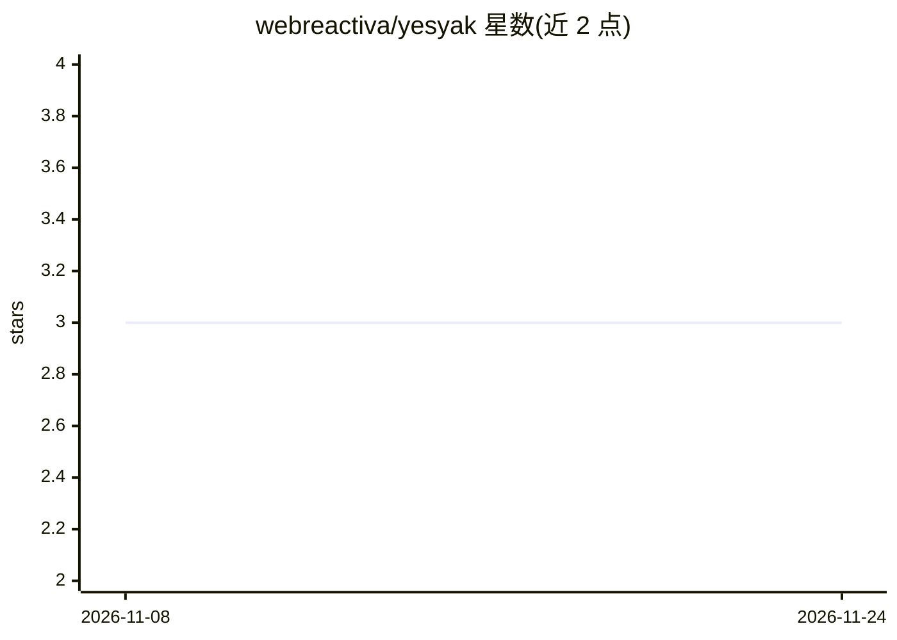

# webreactiva/yesyak

⭐ 3 · Python · MIT · 推送 2026-11-15 · [GitHub](https://github.com/webreactiva/yesyak) · 个人维护

**AI 编码 agent 的技能集：从模糊需求到已评审 PR**

以 SKILL.md 格式发布的 agent 技能集合，核心入口为 yak-pilot：读取用户的自然语言请求，生成计划并经一次批准后独立执行八个阶段——写规格契约、分步实现、验证、红队审查、生成 PR 文本与回顾，仅在预设的门控点（计划、契约、数据变更等）暂停等待人工决策。通过 npx skills add 安装到项目的 skills 文件夹，支持 Claude Code、Codex、OpenCode；需在 AGENTS.md 写入 YesYak 块后才会生效。官方称 35 次基准运行、六种模型上测试过每个技能。

## 筛选速览

| 维度 | 判定 | 备注 |
|---|---|---|
| AI 角色 | `ai-ecosystem` | LLM/agent 周边工具 |
| 许可风险 | `permissive` | MIT |
| 部署形态 | `library` | 以包/库形式分发 |
| 模型依赖 | — | README 未给出锁定关系 |
| 硬件要求 | — | 无带数字的原话,不猜 |
| 安装摩擦 | `low` | 无编译、无系统依赖或容器化 |
| 成熟度 | — | 结构信号不足 |

## 能力要点

- yak-pilot 单入口驱动八个阶段，门控点外独立运行
- 三种协作预设：approver/collaborator/observer 控制人工介入程度
- 回顾阶段把人工纠正转化为守卫（测试、hook、规则）
- check 脚本可在每个阶段结束校验计划合规，可装为 hook

## 适用场景

- 从一句模糊的功能描述生成规格、实现并提交 PR
- 按只读分诊→失败测试→修复的流程处理 bug 报告
- 离开时用 observer 预设让 agent 无人值守完成任务
- 中途暂停后通过 handoff 笔记在新会话中恢复进度

## 场景标签

`编码 Agent` `代码审查` · 领域:编码与开发

## 证据(README 行号)

> L7: YesYak is a set of agent skills that takes a feature from a vague request, or a bug from a report, to a reviewed pul
> L17: The skills follow the open SKILL.md format. Each skill works on its own, except `customize-yak`, which needs `ask-y
> L21:  From install to pull request: install the skills with npx skills add, say set up YesYak, send /yak-pilot with the 

## 星数曲线

2026-11-08 3 → 2026-11-24 3（+0）

---
*卡片 v1 · prompt 1.4 · 生成 2026-11-21 · 置信度 high · 依据 README sha `99a935dc03e2` · [字段定义](../../DATASET.md)*
