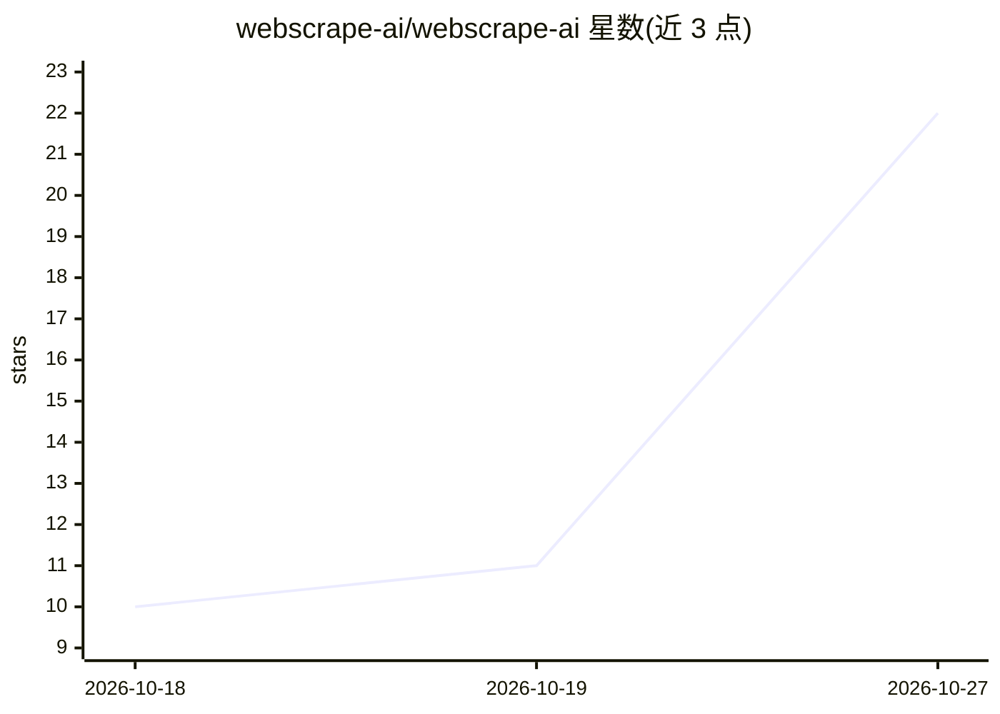

# webscrape-ai/webscrape-ai

⭐ 22 · Java · MIT · 推送 2026-07-07 · [GitHub](https://github.com/webscrape-ai/webscrape-ai) · [官网](https://webscrape.ai) · 组织维护

**webscrape.ai 网页抓取 API 的官方客户端 SDK 集合**

为 webscrape.ai API 提供 Go、Python、Node/TypeScript、Rust、Java 五种语言的官方客户端 SDK。覆盖的接口包括：URL 抓取并转为 HTML/清理后 markdown/链接、LLM 结构化抽取（可选 JSON-schema 校验）、SmartBrowse 任务派发与轮询、用量查询。各 SDK 统一提供速率限制自动指数退避重试（失败请求不收费）、run_and_wait 合并两步调用、WEBSCRAPE_API_KEY 环境变量读取。面向接入该抓取 API 的开发者。

## 筛选速览

| 维度 | 判定 | 备注 |
|---|---|---|
| AI 角色 | `ai-ecosystem` | LLM/agent 周边工具 |
| 许可风险 | `permissive` | MIT |
| 部署形态 | `None` |  |
| 模型依赖 | — | README 未给出锁定关系 |
| 硬件要求 | — | 无带数字的原话,不猜 |
| 安装摩擦 | `low` | 无编译、无系统依赖或容器化 |
| 成熟度 | — | 结构信号不足 |

## 能力要点

- 五种语言 SDK 覆盖同一 API 面
- LLM 结构化抽取端点支持 JSON-schema 校验
- 自动指数退避重试与 run_and_wait 辅助函数
- vendored openapi.yaml 规范与 MIT 许可

## 适用场景

- 在我的应用中调用 webscrape.ai 抓取并清洗网页数据
- 通过 LLM 结构化抽取从页面获得 JSON 数据
- 派发并跟踪 SmartBrowse 抓取任务

## 场景标签

`网页抓取` · 领域:效率与自动化

## 证据(README 行号)

> L1: # webscrape.ai SDKs
> L20: - `POST /v1/smartscraper` — LLM structured extraction with optional JSON-schema validation

## 星数曲线

2026-10-18 10 → 2026-10-27 22（+12）

---
*卡片 v1 · prompt 1.4 · 生成 2026-10-27 · 置信度 high · 依据 README sha `5c2b59164847` · [字段定义](../../DATASET.md)*
