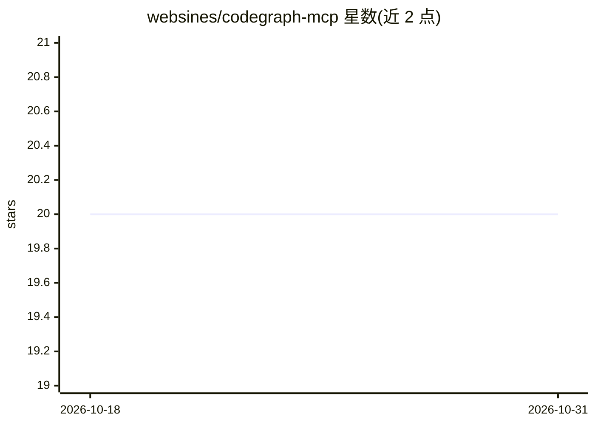

# websines/codegraph-mcp

⭐ 20 · Rust · 推送 2026-02-14 · [GitHub](https://github.com/websines/codegraph-mcp) · [官网](https://www.subh.work/projects/codegraph-mcp) · 个人维护

**给 AI 编码 agent 提供代码图谱与持久记忆的 Rust MCP 服务器**

Rust 编写的 MCP 服务器（stdio/JSON-RPC 2.0），向 AI 编码 agent 暴露 26 个工具：用 tree-sitter 解析 Rust/TS/JS/Python/Go 源码并存储符号关系有向图；跨会话的会话记忆（任务、决策、上下文，可在上下文压缩后恢复）；记录模式/失败/方案谱系的学习系统与反思引擎；生成 SKILL.md 的技能蒸馏；前端调用到后端路由的跨语言推断；以及压缩命令输出以节省 token。存储用 libSQL/SQLite，需 cargo 从源码构建后接入 Claude Code、Cursor 等 MCP 客户端。

## 筛选速览

| 维度 | 判定 | 备注 |
|---|---|---|
| AI 角色 | `ai-ecosystem` | LLM/agent 周边工具 |
| 许可风险 | `none` | — |
| 部署形态 | `None` |  |
| 模型依赖 | — | README 未给出锁定关系 |
| 硬件要求 | — | 无带数字的原话,不猜 |
| 安装摩擦 | `medium` | 含编译或系统依赖之一 |
| 成熟度 | — | 结构信号不足 |

## 能力要点

- tree-sitter 解析 5 种语言，符号与调用/导入/继承关系存为有向图
- 会话记忆在学习/图谱两个数据库中跨会话持久，支持压缩后恢复
- 学习系统记录模式、失败与方案谱系并推荐新任务策略
- 跨语言推断：检测前端 REST/GraphQL 调用并匹配后端路由

## 适用场景

- 让编码 agent 在大型代码库中按符号图检索而少读整文件
- 长任务跨会话延续上下文与项目经验
- 为团队沉淀项目特定知识到 SKILL.md

## 场景标签

`Agent 记忆` · 领域:Agent 开发

## 证据(README 行号)

> L7: Codegraph runs as an MCP server (stdio transport) and exposes 26 tools that an AI agent can call:
> L9: - **Code Graph** — Parses source code with tree-sitter (Rust, TypeScript, JavaScript, Python, Go), extracts symbols 

## 星数曲线

2026-10-18 20 → 2026-10-31 20（+0）

---
*卡片 v1 · prompt 1.4 · 生成 2026-10-28 · 置信度 high · 依据 README sha `094994159087` · [字段定义](../../DATASET.md)*
