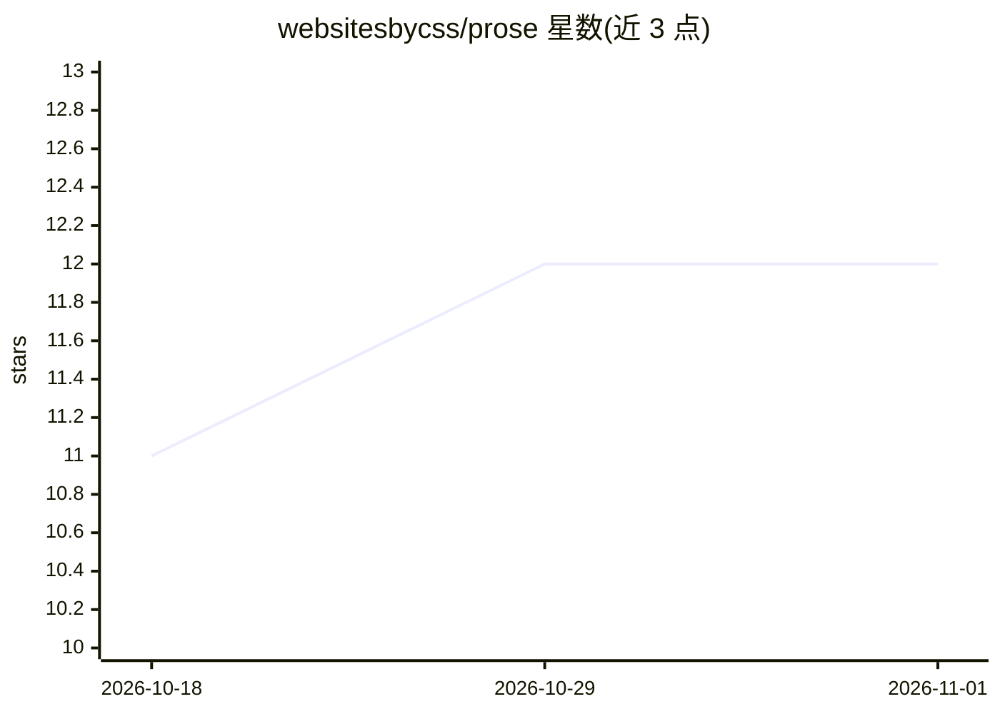

# websitesbycss/prose

⭐ 12 · TypeScript · MIT · 推送 2026-10-13 · [GitHub](https://github.com/websitesbycss/prose) · 个人维护

**Windows 离线办公套件：文档/表格/白板/幻灯片加本地 Ollama AI 助手**

面向 Windows 用户的开源生产力套件，包含文档（Tiptap 富文本编辑、MLA/APA 模板、Harper 语法检查）、表格（Fortune-Sheet、8 种图表）、白板（Excalidraw）与幻灯片四类编辑器，以标签页形式承载多个文件。AI 能力通过本地 Ollama 运行，默认模型 llama3.2:3b，可在设置中切换模型；模型下载后 AI 功能无需联网。安装包从 Releases 获取，首次启动可自动下载 Ollama（约 150 MB），开发者可经 git clone 与 npm 从源码构建。

## 筛选速览

| 维度 | 判定 | 备注 |
|---|---|---|
| AI 角色 | `ai-enhanced` | 去掉 AI 部分产品仍成立 |
| 许可风险 | `permissive` | MIT |
| 部署形态 | `desktop` | 安装包/桌面程序 |
| 模型依赖 | local-ok | 支持本地模型 |
| 硬件要求 | — | 无带数字的原话,不猜 |
| 安装摩擦 | `low` | 无编译、无系统依赖或容器化 |
| 成熟度 | — | 结构信号不足 |

## 能力要点

- 四类编辑器（文档/表格/白板/幻灯片）多标签页承载
- AI 经本地 Ollama 运行，模型下载后离线可用，支持任意 Ollama 模型
- AI 嵌入各编辑器：改写与评析、公式与数据分析、画布头脑风暴、由文字/文档生成幻灯片
- 支持 .docx/.xlsx/.pptx/.md 等格式导入导出与多格式引用生成

## 适用场景

- 在无网络环境下完成写作、表格、画板与演示文稿工作
- 用本地 AI 模型在不联网时改写文档、生成公式与幻灯片
- 管理 MLA/APA 等格式引用与参考文献

## 场景标签

`AI 助手` `数据分析` · 领域:效率与自动化

## 证据(README 行号)

> L3: Prose is an open-source & offline productivity suite for Windows. It contains Documents, Sheets, Boards, and Slides,
> L62: Every model call runs through Ollama on your own hardware. Nothing you write ever leaves your computer. Once a mode
> L64: The AI is wired into each editor rather than bolted on as a chat box. It rewrites and critiques in Documents, write

## 星数曲线

2026-10-18 11 → 2026-11-01 12（+1）

---
*卡片 v1 · prompt 1.4 · 生成 2026-10-31 · 置信度 high · 依据 README sha `2e34c9d983bc` · [字段定义](../../DATASET.md)*
