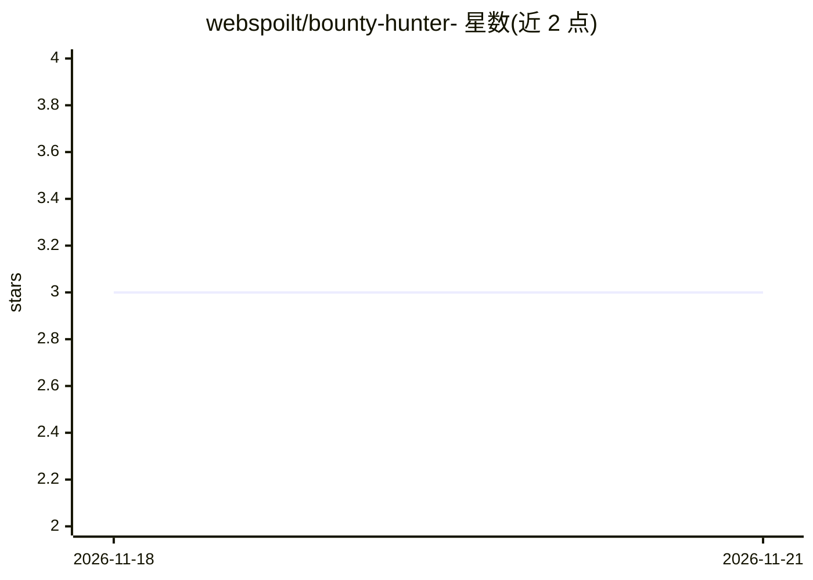

# webspoilt/bounty-hunter-

⭐ 3 · Python · MIT · 推送 2026-11-17 · [GitHub](https://github.com/webspoilt/bounty-hunter-) · 个人维护

**面向 HackerOne 的范围受控授权漏洞挖掘流水线**

bountybot 是一个针对 HackerOne 项目的授权缺陷测量流水线：以默认拒绝的 scope 谓词约束所有出站请求（在解析后的 URL 上判定，含 DNS rebinding 防护），用双身份差分观测规则判定跨账号 IDOR，证据落库前脱敏并存入 SQLite，生成 H1 格式报告；报告可选用本地 LLM 润色（带严格校验），提交环节为人工审批队列，无自动提交代码路径。被动侦察默认执行，子域名枚举仅在 scope 含通配符时委托 cbh。需要 Python 3.11+ 与 httpx，136 项测试无网络运行。

## 筛选速览

| 维度 | 判定 | 备注 |
|---|---|---|
| AI 角色 | `ai-enhanced` | 去掉 AI 部分产品仍成立 |
| 许可风险 | `permissive` | MIT |
| 部署形态 | `library` | 以包/库形式分发 |
| 模型依赖 | local-ok | 支持本地模型 |
| 硬件要求 | — | 无带数字的原话,不猜 |
| 安装摩擦 | `low` | 无编译、无系统依赖或容器化 |
| 成熟度 | — | 结构信号不足 |

## 能力要点

- deny-by-default 的 scope 谓词，10 个绕过用例全部拒绝
- 双身份差分授权判定规则区分已证实与疑似 IDOR
- 证据写入前脱敏、SQLite 溯源存储、人工审批队列
- 可选本地 Ollama 润色报告，bb submit 仅打印 curl 负载

## 适用场景

- 在 HackerOne 项目中按声明范围自动检测授权/IDOR 缺陷
- 对 OWASP Juice Shop 等实验环境做授权测试演练
- 需要脱敏证据与人工审批流程的众测报告产出

## 场景标签

`网络安全` · 领域:学习与行业

## 证据(README 行号)

> L75: |**Reporting**|Deterministic H1 markdown; optional local-LLM polish with strict validation|
> L79: |**Stack**|Python 3.11+, `httpx`, SQLite, optional Ollama, optional Claude-BugHunter|

## 星数曲线

2026-11-18 3 → 2026-11-21 3（+0）

---
*卡片 v1 · prompt 1.4 · 生成 2026-11-21 · 置信度 high · 依据 README sha `32b77f54beba` · [字段定义](../../DATASET.md)*
