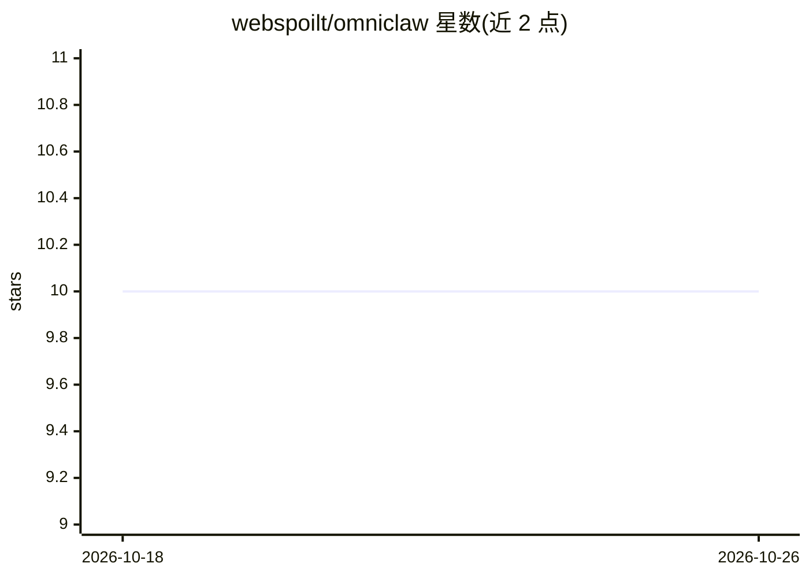

# webspoilt/omniclaw

⭐ 10 · Python · MIT · 推送 2026-06-23 · [GitHub](https://github.com/webspoilt/omniclaw) · [官网](https://omniclaw.vercel.app) · 个人维护

**移除全部安全机制的自主 AI agent 系统研究平台**

从 OmniClaw 分布式编排运行时中系统性移除策略引擎、沙箱、seccomp、能力限制与人工监督后得到的研究工件：以 root 权限运行的无约束 planner–executor 循环，可改写自身源码、派生子 agent，含 62 个技能模块（自我改进、安全审计、OSINT 取证、红队工具）。面向 AI 安全研究人员，用于在物理隔离 VM 中观察工具性收敛与递归自我改进等涌现行为。无许可证，README 明确声明禁止部署于联网机器。

## 筛选速览

| 维度 | 判定 | 备注 |
|---|---|---|
| AI 角色 | `ai-native` | 本体是模型或模型工具 |
| 许可风险 | `permissive` | MIT |
| 部署形态 | `None` |  |
| 模型依赖 | — | README 未给出锁定关系 |
| 硬件要求 | — | 无带数字的原话,不猜 |
| 安装摩擦 | `low` | 无编译、无系统依赖或容器化 |
| 成熟度 | `idea` | |

## 能力要点

- 以 root 运行的无约束 planner–executor 循环，可改写自身源码并派生子 agent
- 62 个技能模块：自我改进、安全审计、网络/OSINT 取证、红队工具
- 多模型 worker 池编排（Debate/Aggregation/Build-Debug 三种策略，Fugu 架构）
- 要求物理隔离 VM 与硬件隔离等容器化实验协议

## 适用场景

- 在隔离环境中研究无约束 agent 的涌现行为
- 观察工具性收敛与递归自我改进现象
- 研究 agent 安全机制的必要性实证

## 场景标签

`多智能体` `网络安全` · 领域:Agent 开发

## 证据(README 行号)

> L56: This paper presents the design, implementation, and experimental framework for a **maximally autonomous, self-impro
> L62: The system now includes a complete **Evolution & Red-Team Toolkit** — six high-impact modules that elevate the agen

## 星数曲线

2026-10-18 10 → 2026-10-26 10（+0）

---
*卡片 v1 · prompt 1.4 · 生成 2026-10-18 · 置信度 mid · 依据 README sha `b846057fda52` · [字段定义](../../DATASET.md)*
