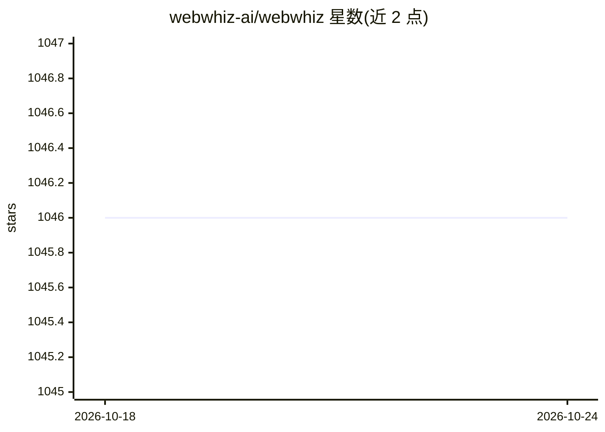

# webwhiz-ai/webwhiz

⭐ 1,046 · TypeScript · AGPL-3.0 · 推送 2026-01-08 · [GitHub](https://github.com/webwhiz-ai/webwhiz) · [官网](https://www.webwhiz.ai/) · 组织维护

**自托管工具：用网站数据训练 ChatGPT 构建客服聊天机器人**

输入网站 URL 后自动抓取页面生成训练数据，基于 OpenAI 接口训练 ChatGPT 并生成可嵌入网站的聊天机器人（script 标签或 npm SDK 引入），提供无代码构建器、自定义外观、定期数据更新与自定义数据粘贴训练。自托管架构含 NestJS API 服务、JS/Python Celery Worker 三个组件，依赖 MongoDB、Redis（embeddings 存于 Redis）与 OpenAI API key（必填）。AGPLv3 许可，支持 Docker 一键部署或手动部署。

## 筛选速览

| 维度 | 判定 | 备注 |
|---|---|---|
| AI 角色 | `ai-native` | 本体是模型或模型工具 |
| 许可风险 | `viral` | AGPL-3.0 |
| 部署形态 | `library` | 以包/库形式分发 |
| 模型依赖 | — | README 未给出锁定关系 |
| 硬件要求 | — | 无带数字的原话,不猜 |
| 安装摩擦 | `low` | 无编译、无系统依赖或容器化 |
| 成熟度 | — | 结构信号不足 |

## 能力要点

- 输入 URL 自动抓取并训练网站问答机器人
- 嵌入脚本标签或 npm SDK 即可挂载到网站
- 三组件架构：NestJS API + JS/Python Celery Worker，embeddings 存 Redis
- Docker Compose 自托管部署

## 适用场景

- 给产品官网挂一个能回答客户问题的 AI 客服
- 自托管并控制聊天机器人的数据与部署
- 用自定义粘贴内容补充训练数据

## 场景标签

`聊天机器人` · 领域:对话与助手

## 证据(README 行号)

> L3: Train ChatGPT on Your Website Data and Build an AI Chatbot that can instantly answer your customers queries.
> L21: - We’ll automatically train ChatGPT on your website based on the selected parameters and create the chatbot for you
> L110: The backend server uses third part services (including OpenAI) for powering the chatbot, as well as for error moni

## 星数曲线

2026-10-18 1,046 → 2026-10-24 1,046（+0）

---
*卡片 v1 · prompt 1.4 · 生成 2026-10-21 · 置信度 high · 依据 README sha `9b3d3c18e584` · [字段定义](../../DATASET.md)*
