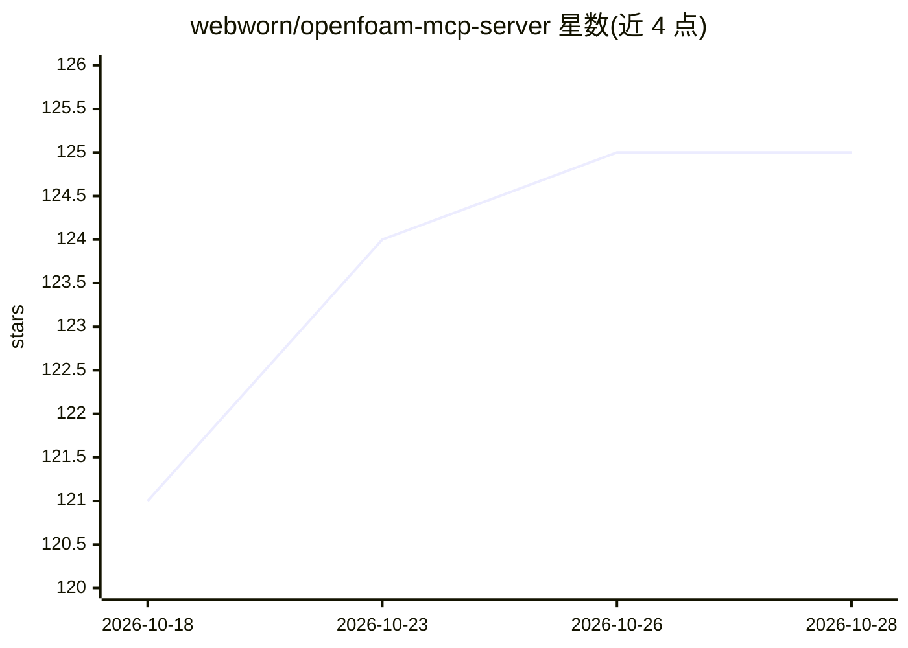

# webworn/openfoam-mcp-server

⭐ 125 · C++ · NOASSERTION · 推送 2026-01-18 · [GitHub](https://github.com/webworn/openfoam-mcp-server) · 个人维护

**面向 CFD 教学的 OpenFOAM MCP 服务器，提供苏格拉底式提问与错误诊断**

基于 JSON-RPC 2.0 的 Model Context Protocol 服务器，注册 12 个工具，供 Claude Code 等 MCP 客户端调用以操作 OpenFOAM：执行网格、求解、后处理操作，分析管流/湍流/外流/传热/多相流结果，评估网格质量与 STL 几何，并包含 2D/3D 旋转爆震发动机（RDE）分析与几何生成套件。教育侧提供苏格拉底式提问引擎（4 种提问模式）、用户概念建模与自适应复杂度、自然语言到 CFD 参数的抽取与置信评分、5 Whys 错误根因分析。README 自述系统整体 75% 可用，OpenFOAM 集成为部分可用（OF12 求解器迁移待完成），传热与多相流仍在开发中。

## 筛选速览

| 维度 | 判定 | 备注 |
|---|---|---|
| AI 角色 | `ai-ecosystem` | LLM/agent 周边工具 |
| 许可风险 | `none` | NOASSERTION |
| 部署形态 | `None` |  |
| 模型依赖 | — | README 未给出锁定关系 |
| 硬件要求 | — | 无带数字的原话,不猜 |
| 安装摩擦 | `medium` | 含编译或系统依赖之一 |
| 成熟度 | `idea` | |

## 能力要点

- 12 个 MCP 工具覆盖 OpenFOAM 执行、结果分析、网格质量与 STL 几何检查
- 苏格拉底式提问引擎（CLARIFY/EXPLORE/CONFIRM/APPLY 四种模式）与自适应复杂度
- 2D/3D RDE 波分析、环形几何生成与性能计算（推力/Isp/效率）
- 5 Whys 错误根因分析与学术文献依据的解决方案

## 适用场景

- 通过 Claude Code 等 MCP 客户端以对话方式学习和求解 CFD 问题
- 分析 OpenFOAM 网格质量与 STL 几何，获得 snappyHexMesh 修复指导
- 进行管流/湍流分析并获得物理参数与 y+ 网格建议
- 生成和分析旋转爆震发动机（RDE）2D/3D 算例

## 场景标签

 · 领域:CFD/科学计算工具

## 证据(README 行号)

> L3: 🚀 **Intelligent CFD education and problem-solving system** - OpenFOAM Model Context Protocol server with AI-powered 
> L14: |**MCP Server**|✅ **Working**|JSON-RPC 2.0, 12 registered tools, Claude Code integration|
> L94: |`execute_openfoam_operation`|Execute OpenFOAM operations (mesh, solve, post-process)|✅ Working|

## 星数曲线

2026-10-18 121 → 2026-10-28 125（+4）

---
*卡片 v1 · prompt 1.4 · 生成 2026-10-23 · 置信度 high · 依据 README sha `9ac2c7d19690` · [字段定义](../../DATASET.md)*
