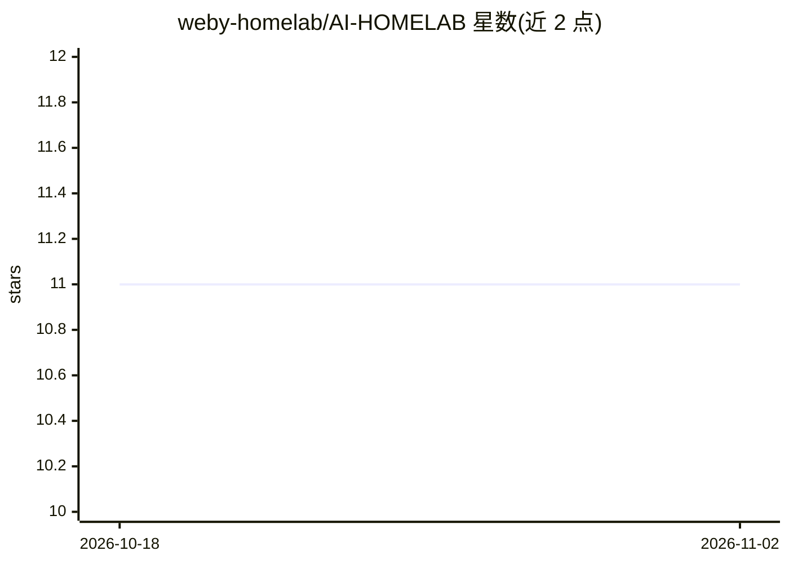

# weby-homelab/AI-HOMELAB

⭐ 11 · Python · MIT · 推送 2026-09-06 · [GitHub](https://github.com/weby-homelab/AI-HOMELAB) · [官网](https://AI.Weby.guru) · 组织维护

**乌克兰本地 AI 家庭实验室指南：低成本自建本地模型与多智能体**

面向乌克兰用户的开源社区项目，提供在家庭环境、有限预算下部署本地 AI 的完整指南与配置集合：涵盖本地推理（Ollama/vLLM/llama.cpp）、多智能体编排（LangGraph/CrewAI/PydanticAI）、RAG 模板、MCP 工具层架构，以及针对停电场景的能效优化（功耗 80-150W、搭配便携电源）。仓库提供 Docker-compose 配置（Ollama+Open WebUI 一键栈、生产级 agent 栈）、代码模板与分 OS 安装文档，多个模块标注 coming soon。内容以乌克兰语撰写，附模型使用政策备忘录。

## 筛选速览

| 维度 | 判定 | 备注 |
|---|---|---|
| AI 角色 | `ai-knowledge` | 知识聚合/清单类 |
| 许可风险 | `permissive` | MIT |
| 部署形态 | `self-host` | docker 或自建部署 |
| 模型依赖 | local-ok | 支持本地模型 |
| 硬件要求 | `cpu-ok` | |
| 安装摩擦 | `low` | 无编译、无系统依赖或容器化 |
| 成熟度 | — | 结构信号不足 |

## 能力要点

- 三层架构（编排↔推理↔MCP 工具）参考实现与文档
- 面向消费级硬件（RTX 3060/4060、Apple Silicon）与停电韧性的能效指南
- 提供 Ollama+Open WebUI 一键栈与含 LiteLLM/Qdrant/n8n 的生产级 docker-compose 配置
- Corrective RAG Agent、Agent 持久记忆等代码模板

## 适用场景

- 在家庭服务器上搭建本地 LLM 推理与 Web 界面
- 学习和搭建多智能体编排与 RAG 流水线
- 停电环境下维持低功耗本地 AI 服务
- 按分 OS 文档快速跑起第一个本地模型

## 场景标签

`RAG` `多智能体` `教程课程` · 领域:Agent 开发

## 证据(README 行号)

> L13: Ласкаво просимо до центрального репозиторію ініціативи **AI-HomeLab**! Цей проєкт створено для того, щоб сформувати
> L177: ├── 📁 **`configs/`** — _Готові Docker-compose конфігурації_
> L186: ├── 📁 **`templates/`** — _Шаблони та приклади коду_

## 星数曲线

2026-10-18 11 → 2026-11-02 11（+0）

---
*卡片 v1 · prompt 1.4 · 生成 2026-11-01 · 置信度 mid · 依据 README sha `7ead2498e842` · [字段定义](../../DATASET.md)*
