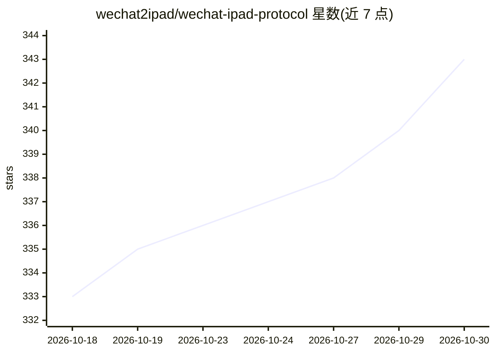

# wechat2ipad/wechat-ipad-protocol

⭐ 343 · Apache-2.0 · 推送 2026-10-29 · [GitHub](https://github.com/wechat2ipad/wechat-ipad-protocol) · 个人维护 · 中文 README

**微信 iPad 协议接口：为 AI 客服与私域运营提供微信底层接入**

付费交付的微信 iPad 协议接口能力，提供登录态维护、长连接保活、消息收发、WebSocket 实时消息同步、好友/群/朋友圈/公众号接口及多账号管理，面向 AI 客服、私域运营、SCRM、微信机器人开发者，可通过回调链路对接大模型实现自动回复。商业模式为源码购买（5000-10000 元/套）、账号租用（200 元/月）或私有化部署，更新与维保需另付费；不提供免费安装渠道，需通过 QQ 联系获取。

## 筛选速览

| 维度 | 判定 | 备注 |
|---|---|---|
| AI 角色 | `ai-ecosystem` | LLM/agent 周边工具 |
| 许可风险 | `permissive` | Apache-2.0 |
| 部署形态 | `None` |  |
| 模型依赖 | — | README 未给出锁定关系 |
| 硬件要求 | — | 无带数字的原话,不猜 |
| 安装摩擦 | `low` | 无编译、无系统依赖或容器化 |
| 成熟度 | — | 结构信号不足 |

## 能力要点

- 扫码/A16/62 数据多种登录方式与自动心跳、自动二登
- WebSocket 长连接实时消息同步与多账号消息区分
- 好友、群、朋友圈、公众号、文件媒体等接口能力
- 支持私有化部署与多语言二次开发

## 适用场景

- 为 AI 客服/微信机器人业务接入微信消息收发底层能力
- 搭建多客服聚合聊天或私域 SCRM 系统
- 按月租用账号短期验证 AI 客服项目

## 场景标签

 · 领域:即时通讯协议/私域运营基础设施

## 证据(README 行号)

> L132: ## 微信 iPad 协议接口 / 微信 AI 机器人基础能力 / 私域客服自动化解决方案
> L345: 微信消息 -> WS 回调 -> 业务系统 -> AI 模型 -> 回复微信
> L364: 最近很多客户在做微信 AI 客服，本项目非常适合作为底层微信接入层。

## 星数曲线

2026-10-18 333 → 2026-10-30 343（+10）

---
*卡片 v1 · prompt 1.4 · 生成 2026-10-21 · 置信度 mid · 依据 README sha `e66acd4097f3` · [字段定义](../../DATASET.md)*
