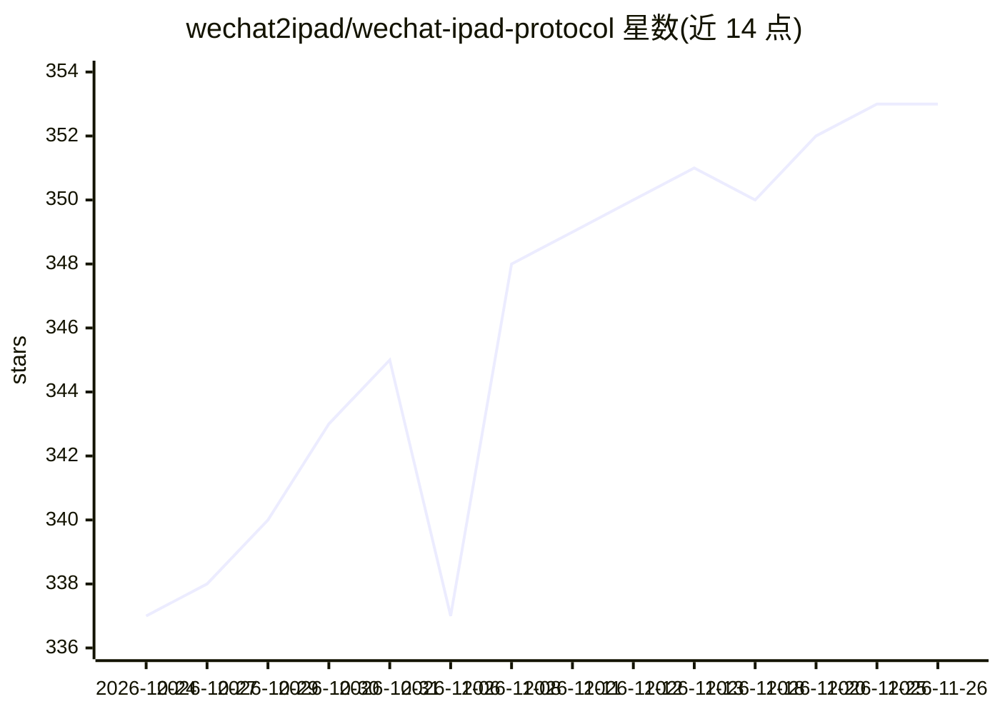

# wechat2ipad/wechat-ipad-protocol

⭐ 353 · Apache-2.0 · 推送 2026-11-25 · [GitHub](https://github.com/wechat2ipad/wechat-ipad-protocol) · 个人维护 · 中文 README

**供 AI 客服/SCRM/机器人系统接入的微信 iPad 协议接口**

一套按付费方式提供的微信 iPad 协议接口能力，覆盖登录态维护（扫码/A16/62 数据登录、心跳、二次登录）、消息收发与 WS 实时回调、好友/群/朋友圈/公众号操作、多账号管理与私有化部署。README 未提供可自行执行的安装命令，获取方式为联系 QQ 购买源码交付、非源码私有化部署包或按号租用。面向 AI 客服、私域运营、SCRM 等系统的开发与运营团队，支持 Go/Python/Java/Node.js/PHP 二次开发。

## 筛选速览

| 维度 | 判定 | 备注 |
|---|---|---|
| AI 角色 | `ai-enhanced` | 去掉 AI 部分产品仍成立 |
| 许可风险 | `permissive` | Apache-2.0 |
| 部署形态 | `None` |  |
| 模型依赖 | — | README 未给出锁定关系 |
| 硬件要求 | — | 无带数字的原话,不猜 |
| 安装摩擦 | `low` | 无编译、无系统依赖或容器化 |
| 成熟度 | — | 结构信号不足 |

## 能力要点

- WebSocket 长连接消息同步：自动心跳、断线重连、多账号消息区分
- 登录态管理：扫码/A16/62 数据登录、代理配置、自动二次登录
- 好友、群、朋友圈、公众号、红包等接口调用能力
- 提供源码交付、私有化部署包与按月租用三种付费形态

## 适用场景

- 给微信 AI 客服机器人提供消息收发底层接口
- 私域运营中批量管理好友、标签与朋友圈内容
- 多微信号统一接入企业客服/SCRM 后台
- 对接企业知识库做 RAG 问答机器人

## 场景标签

 · 领域:即时通讯/营销自动化接口

## 证据(README 行号)

> L132: > 面向 AI 客服、私域运营、SCRM、自动化消息系统、微信机器人、企业内部工具开发者，提供稳定的微信 iPad 协议接口能力。
> L167: **它不是一个简单机器人，而是一套可以接入你业务系统的微信底层接口能力。**
> L343: 微信消息 -> WS 回调 -> 业务系统 -> AI 模型 -> 回复微信

## 星数曲线

2026-10-24 337 → 2026-11-26 353（+16）

---
*卡片 v1 · prompt 1.4 · 生成 2026-11-26 · 置信度 mid · 依据 README sha `cf10688103f1` · [字段定义](../../DATASET.md)*
