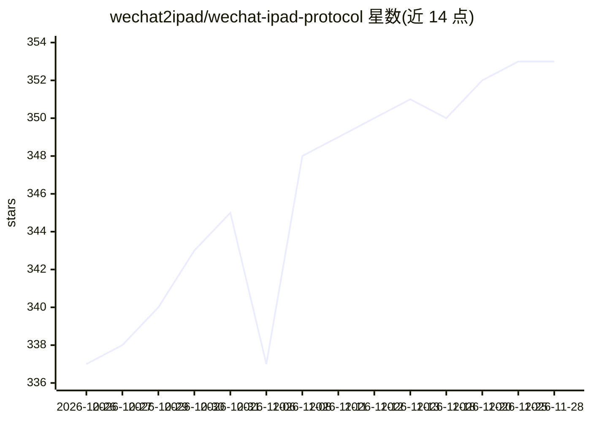

# wechat2ipad/wechat-ipad-protocol

⭐ 353 · Apache-2.0 · 推送 2026-11-27 · [GitHub](https://github.com/wechat2ipad/wechat-ipad-protocol) · 个人维护 · 中文 README

**给做微信客服/机器人的开发者提供微信iPad协议接口能力**

一套微信 iPad 协议接口，提供登录态管理、消息收发、好友/群/朋友圈/公众号操作、WebSocket 实时消息同步与多账号接入能力，面向 AI 客服、私域运营、SCRM 与微信机器人开发者。通过源码购买（5000-10000 元/套）或按号租用（200 元/月）交付，接口地址需联系 QQ 获取；更新与维保自 2025 年起改为按次收费。README 未提供可直接运行的公开安装命令。

## 筛选速览

| 维度 | 判定 | 备注 |
|---|---|---|
| AI 角色 | `ai-enhanced` | 去掉 AI 部分产品仍成立 |
| 许可风险 | `permissive` | Apache-2.0 |
| 部署形态 | `None` |  |
| 模型依赖 | — | README 未给出锁定关系 |
| 硬件要求 | — | 无带数字的原话,不猜 |
| 安装摩擦 | `low` | 无编译、无系统依赖或容器化 |
| 成熟度 | — | 结构信号不足 |

## 能力要点

- 登录态维护：扫码/A16/62 登录、自动心跳、二次登录、多账号管理
- WebSocket 长连接实时消息同步与回调
- 好友、群、朋友圈、公众号、媒体文件接口覆盖
- 支持私有化部署与 Go/Python/Java/Node.js/PHP 二次开发

## 适用场景

- 接入大模型做微信 AI 客服与自动回复
- 私域 SCRM 与多客服聚合聊天系统
- 群消息监听与社群运营自动化
- 对接 CRM/ERP 做客户资料沉淀与消息归档

## 场景标签

`工作流自动化` · 领域:效率与自动化

## 证据(README 行号)

> L132: > 面向 AI 客服、私域运营、SCRM、自动化消息系统、微信机器人、企业内部工具开发者，提供稳定的微信 iPad 协议接口能力。
> L343: 微信消息 -> WS 回调 -> 业务系统 -> AI 模型 -> 回复微信
> L660: 本项目仅提供技术接口能力，用于学习研究、系统集成、企业内部工具、AI 客服、私域运营辅助等场景。

## 星数曲线

2026-10-26 337 → 2026-11-28 353（+16）

---
*卡片 v1 · prompt 1.4 · 生成 2026-11-28 · 置信度 mid · 依据 README sha `878be0a2ea9b` · [字段定义](../../DATASET.md)*
