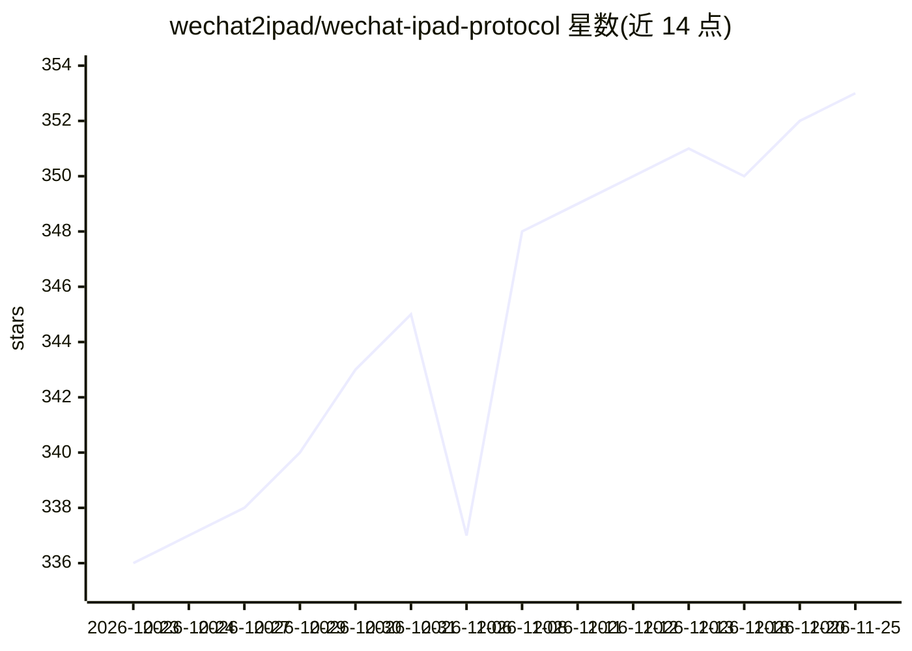

# wechat2ipad/wechat-ipad-protocol

⭐ 353 · Apache-2.0 · 推送 2026-11-23 · [GitHub](https://github.com/wechat2ipad/wechat-ipad-protocol) · 组织维护 · 中文 README

**微信 iPad 协议接口：供 AI 客服/私域系统接入微信收发消息**

一套以付费方式交付的微信 iPad 协议接口，提供登录态维护（扫码/A16/62 登录、心跳、二次登录）、消息收发、WebSocket 实时消息同步、好友/群/朋友圈/公众号管理与多账号接入能力。README 面向 AI 客服、私域运营、SCRM、微信机器人与企业内部工具的开发者，定位为业务系统的底层微信接入层，可对接大模型、知识库与 CRM。交付方式为源码购买（标注价格）、非源码私有化部署或按账号月租，更新与维保在声明日期后收费；README 未提供可执行的公开安装命令，获取接口地址需联系给定 QQ。

## 筛选速览

| 维度 | 判定 | 备注 |
|---|---|---|
| AI 角色 | `ai-enhanced` | 去掉 AI 部分产品仍成立 |
| 许可风险 | `permissive` | Apache-2.0 |
| 部署形态 | `None` |  |
| 模型依赖 | — | README 未给出锁定关系 |
| 硬件要求 | — | 无带数字的原话,不猜 |
| 安装摩擦 | `low` | 无编译、无系统依赖或容器化 |
| 成熟度 | — | 结构信号不足 |

## 能力要点

- 提供扫码/A16/62 登录、自动心跳、自动二次登录与多账号管理
- 提供 WebSocket 长连接实时消息同步与消息回调
- 覆盖消息收发、好友、群、朋友圈、公众号等微信接口
- 支持私有化部署与二次开发，交付方式为源码购买/部署包/按账号租用

## 适用场景

- 给微信 AI 客服机器人提供消息收发底层接口
- 私域 SCRM 系统做多微信号统一接入与管理
- 社群运营机器人监听群消息并自动回复
- 企业内部工具通过 WS 回调对接大模型做自动应答

## 场景标签

`聊天机器人` · 领域:对话与助手

## 证据(README 行号)

> L130: ## 微信 iPad 协议接口 / 微信 AI 机器人基础能力 / 私域客服自动化解决方案
> L343: 微信消息 -> WS 回调 -> 业务系统 -> AI 模型 -> 回复微信
> L686: **Wechat-iPad-Protocol 是一套适合 AI 客服、私域运营、微信机器人和 SCRM 系统接入的微信 iPad 协议接口能力，支持源码交付、私有化部署、多账号接入和二次开发。**

## 星数曲线

2026-10-23 336 → 2026-11-25 353（+17）

---
*卡片 v1 · prompt 1.4 · 生成 2026-11-25 · 置信度 high · 依据 README sha `b5773a7671f0` · [字段定义](../../DATASET.md)*
