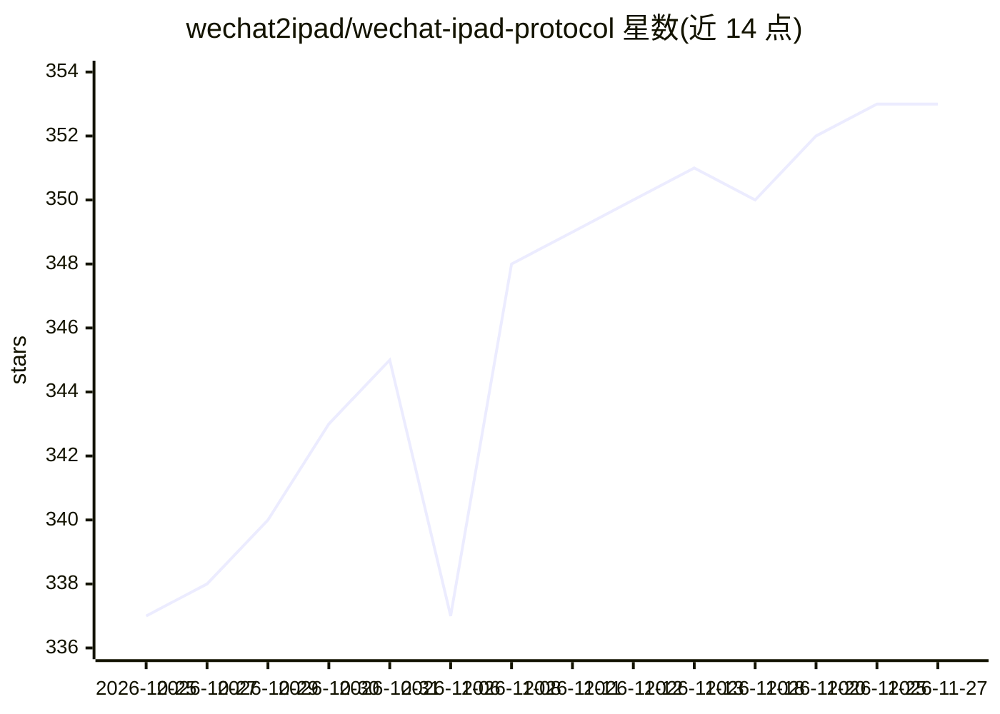

# wechat2ipad/wechat-ipad-protocol

⭐ 353 · Apache-2.0 · 推送 2026-11-26 · [GitHub](https://github.com/wechat2ipad/wechat-ipad-protocol) · 个人维护 · 中文 README

**给AI客服/私域运营团队提供微信iPad协议接口能力**

一套商业售卖的微信 iPad 协议接口，提供登录态维护、消息收发、好友/群/朋友圈/公众号管理及 WebSocket 实时消息同步等能力，面向 AI 客服、私域运营、SCRM 与微信机器人开发者，支持 Go、Python、Java、Node.js、PHP 等语言二次开发。交付方式为源码购买（5000/1 万元）、非源码私有化部署（5k）或按账号租用（200 元/月/号）；2025 年 8 月起版本升级统一收费 800 元/次，维保期后调整为 30 日。需通过 QQ 联系获取接口地址与部署说明。

## 筛选速览

| 维度 | 判定 | 备注 |
|---|---|---|
| AI 角色 | `ai-enhanced` | 去掉 AI 部分产品仍成立 |
| 许可风险 | `permissive` | Apache-2.0 |
| 部署形态 | `None` |  |
| 模型依赖 | — | README 未给出锁定关系 |
| 硬件要求 | — | 无带数字的原话,不猜 |
| 安装摩擦 | `low` | 无编译、无系统依赖或容器化 |
| 成熟度 | — | 结构信号不足 |

## 能力要点

- 提供扫码/A16/62 数据登录与心跳、二次登录等登录态维护能力
- WebSocket 长连接实时消息同步，支持多账号消息区分与断线重连
- 覆盖好友、群、朋友圈、公众号、文件媒体等接口
- 源码交付、私有化部署与按号租用三种商业交付方式

## 适用场景

- 在微信上接入 AI 客服机器人自动回复用户
- 搭建私域 SCRM 与多客服聚合聊天系统
- 对接企业知识库做微信端问答机器人
- 批量管理多微信号的消息归档与运营

## 场景标签

`聊天机器人` · 领域:对话与助手

## 证据(README 行号)

> L132: > 面向 AI 客服、私域运营、SCRM、自动化消息系统、微信机器人、企业内部工具开发者，提供稳定的微信 iPad 协议接口能力。
> L179: - AI 大模型接入
> L343: 微信消息 -> WS 回调 -> 业务系统 -> AI 模型 -> 回复微信

## 星数曲线

2026-10-25 337 → 2026-11-27 353（+16）

---
*卡片 v1 · prompt 1.4 · 生成 2026-11-27 · 置信度 high · 依据 README sha `75a6191846ed` · [字段定义](../../DATASET.md)*
