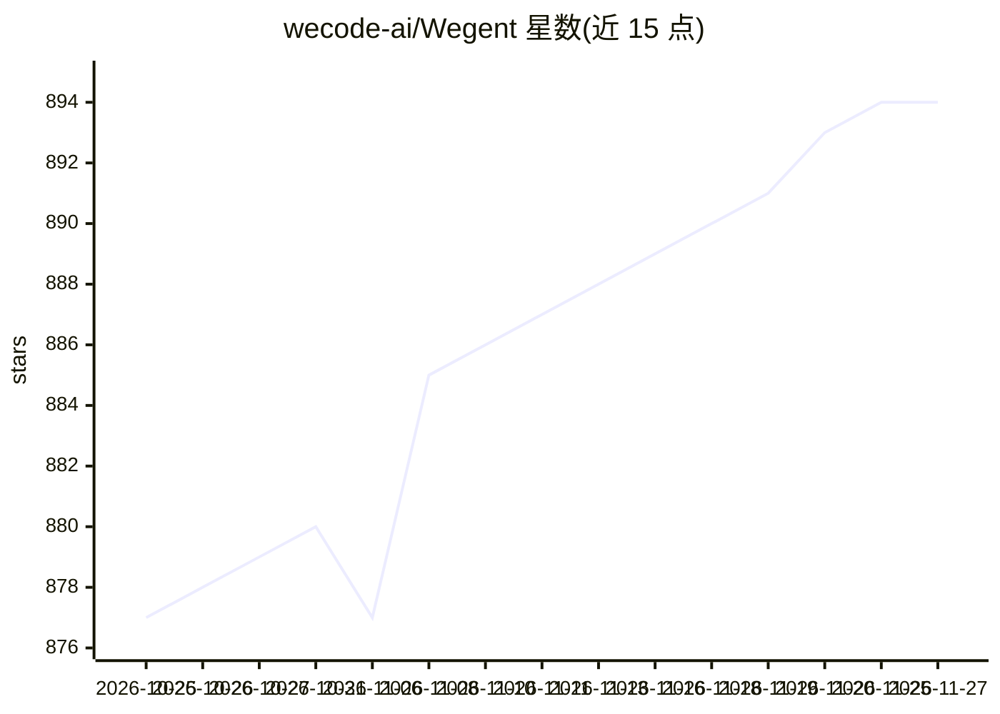

# wecode-ai/Wegent

⭐ 894 · TypeScript · Apache-2.0 · 推送 2026-11-26 · [GitHub](https://github.com/wecode-ai/Wegent) · [官网](https://wecode-ai.github.io/wegent-docs) · 组织维护 · 中文 README

**面向团队的开源 AI 协作工作台：以 Issue 分配、执行并交付任务**

Wegent 以 Issue 为核心，将团队成员、AI agent 与个人代理组织在同一项目空间，覆盖分配、执行、交付与讨论全流程并保留记录。桌面端（Electron）提供本地编码工作台，由 Executor 驱动 Codex 处理文件、命令与测试；Web/Backend 支持 Docker 自部署以管理权限、模型、调度与知识服务。新项目默认不添加 agent、不启用个人代理，需显式配置执行环境与模型。

## 筛选速览

| 维度 | 判定 | 备注 |
|---|---|---|
| AI 角色 | `ai-native` | 本体是模型或模型工具 |
| 许可风险 | `permissive` | Apache-2.0 |
| 部署形态 | `library` | 以包/库形式分发 |
| 模型依赖 | — | README 未给出锁定关系 |
| 硬件要求 | — | 无带数字的原话,不猜 |
| 安装摩擦 | `low` | 无编译、无系统依赖或容器化 |
| 成熟度 | — | 结构信号不足 |

## 能力要点

- Issue 驱动的人机协作流程：分配→执行→交付→讨论→交接
- 桌面端本地编码工作台，直接驱动 Codex 执行并审查工具活动与 diff
- Web/Backend 可 Docker 自部署，管理权限、模型、调度与执行设备
- 个人代理（Beta）按配置职责与处理策略接收工作，交回人工确认

## 适用场景

- 团队围绕同一 Issue 把任务分配给成员或 AI agent 并追踪交付
- 在本地项目中用 AI 处理代码修改、命令运行与测试验证
- 自托管部署以管理团队的模型配置与远程执行设备

## 场景标签

`编码 Agent` · 领域:编码与开发

## 证据(README 行号)

> L14: Wegent brings team members, AI agents, and personal stand-ins together around the same Issue: describe a goal, assi
> L44: - **Local coding workbench** — Use Codex directly with project code, files, commands, and development environments.
> L114: In the desktop architecture, Electron provides system capabilities and process management, DeepSeek Harness (DSH) 

## 星数曲线

2026-10-25 877 → 2026-11-27 894（+17）

---
*卡片 v1 · prompt 1.4 · 生成 2026-11-24 · 置信度 high · 依据 README sha `7e78b43fecf6` · [字段定义](../../DATASET.md)*
